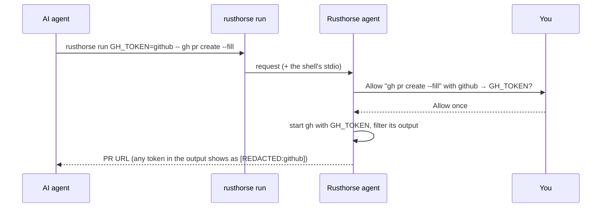

# Using Rusthorse with AI agents

Rusthorse was built for one situation in particular: an AI coding agent
(Claude Code, Codex, Aider, an MCP tool, …) runs commands in your shell and
needs a credential to do its job. This guide shows how to set that up and how
to approve requests safely.

## The idea in one picture



The AI composes the command; you decide whether it runs; the secret goes
from the vault straight into the approved program.

## Setting up an agent

1. Store the secrets the agent will need, with names it can use directly:

   ```sh
   rusthorse add ANTHROPIC_API_KEY --kind api-key --url https://api.anthropic.com --tag ai
   rusthorse add github --kind login --username me --url https://github.com --tag dev
   rusthorse add core-router --kind device --username admin --url https://10.0.0.1/ --host 10.0.0.1 --tag network
   ```

   The [kind](cli.md#entry-kinds) tells the agent what each entry is; for an
   API key, `--url` is the API's endpoint, which the agent can pass to a
   program with `rusthorse run --url` (it is not a secret).

2. Tell the agent how to use them. Put this in `CLAUDE.md`, `AGENTS.md` or the
   equivalent instructions file:

   ```markdown
   ## Secrets
   - Secrets are managed by Rusthorse. `rusthorse list --json` shows what
     exists (names, kinds, usernames, URLs, hosts, ports, tags — never
     values); `rusthorse list --kind api-key` lists the API keys.
   - To use a secret, run the command through Rusthorse:
     `rusthorse run NAME -- command args` or `rusthorse run VAR=NAME -- …`.
     The human approves each use in a dialog. For an API key with an
     endpoint, add `--url VAR=NAME` to pass the endpoint too, e.g.
     `rusthorse run OPENAI_API_KEY --url OPENAI_BASE_URL=OPENAI_API_KEY -- …`.
   - Never ask the human for a secret value, never print or echo secrets,
     never write them to files, and never use `rusthorse reveal`.
   - Exit status 125 with a `rusthorse:` message means Rusthorse refused or
     failed before the command started — including when the agent is not
     running or is out of date — so the command did not run; if it was
     denied — or nobody answered the dialog in time — stop and ask the human
     instead of retrying a variation. Exit status 124 means the
     outcome is unknown (the connection was lost after the request was sent,
     or the agent could not confirm the result): the command may or may not
     have run, so check before repeating anything that is not idempotent.
     (A command can also exit with 124 or 125 itself; the `rusthorse:` message
     tells them apart.)
   - To store a new secret, run
     `rusthorse add NAME [--kind …] [--url …] [--username …]`;
     the human types the value in a dialog. Do not pipe values into
     `rusthorse add --stdin`.
   - Commands run by `rusthorse run` read no input unless you add `--stdin`,
     and background processes they start are stopped when they exit.
   ```

3. Keep `rusthorse agent` running under systemd (see
   [installation.md](installation.md)). Never let the AI start the agent.

4. Ask the AI to run `rusthorse doctor`. This checks, from the AI's own shell,
   that it finds `rusthorse` (if not, see
   [installation.md](installation.md#1-build-and-install)) and reaches the
   agent.

## Approving requests

The dialog is where your security comes from. Before clicking **Allow**, read
these lines:

| Line | Ask yourself |
|---|---|
| **Command** | Is this what I expected the agent to do right now? Does it send data anywhere (`curl`, `nc`, `ssh`, `git push`)? |
| **Program** | Is this the real tool (`/usr/bin/gh`), or something in a project or temporary directory? |
| **Directory** | Is the agent working where I think it is? |
| **Secrets** | Does this command need *these* secrets? An API key for a model has no business in `git push`. |
| **Requested by (unverified)** | Is it the AI's shell, or something unexpected? These are process names, which any program can choose, so they inform but do not prove who asked. |
| **Connects to (environment)** | Is every host one you expect — the provider's real API, your own database? An AI agent can set `OPENAI_BASE_URL` or `DATABASE_URL` to a server of its own, and the approved program would send the secret there. |
| **Warnings** | `NODE_OPTIONS`, `PYTHONPATH`, `GIT_SSH_COMMAND` and similar can make the program run other code. A proxy (`HTTPS_PROXY`) or a certificate variable (`SSL_CERT_FILE`, `NODE_TLS_REJECT_UNAUTHORIZED`) lets someone else see or redirect its connections. Deny unless you know why they are set. |

A `\u{…}` in a dialog stands for a character Rusthorse does not draw as
itself — a line break, an invisible or combining character, a letter of
another script, an emoji. `\u{a}` is a line break. The request may also
contain those six characters literally, which looks the same: take any
`\u{…}` for the character it names, and look closer at anything unexpected
before you allow it.

Be especially careful with:

- **Shell one-liners** (`sh -c '…'`, `bash -c '…'`). Everything inside runs
  with the secret. Read the whole string.
- **Scripts in the project** (`python deploy.py`, `./run.sh`, `npm run x`).
  You are approving whatever the file contains *now*, and the AI can edit
  files. If it just changed the script, look at the change first.
- **Interpreters with an inline program** (`python -c`, `node -e`).
- **`--no-redact`**. The output will contain the secret if the program
  prints it.

**Remembered approvals** ("Allow for N") are off by default. If you enable
them (`rusthorse agent --remember 5m`), they skip the dialog for *identical*
requests — same command line, program, directory, secrets, environment and
vault state — but not for what the command reads: an agent can change a
script, a config file or the command's input between runs. Enable them only
for commands whose inputs you control, and use `rusthorse lock` when you
step away.

**Sandboxed agents.** If the AI agent runs in a sandbox (restricted network,
read-only file system, container), remember that the command you approve is
started by Rusthorse *outside* that sandbox, with your full access. The
dialog says so on the "Runs" line.

When something looks wrong, click **Deny**. The command does not run, the AI
gets exit status 125, and the denial is in `rusthorse audit`.

## What this protects against — and what it does not

Rusthorse is effective against the problems that actually happen with
cooperative-but-fallible agents:

- the secret never appears in the conversation, the agent's context window,
  its transcripts or its tool logs;
- the agent cannot quietly use a credential for something you did not see;
- output that happens to contain the secret is redacted;
- there is a record of every use.

It cannot make a malicious agent harmless when the agent runs as you in your
desktop session. An agent that is actively trying to steal a secret can get
it — by encoding it in an approved command's output, by having a script send
it somewhere, by reading `/proc/<pid>/environ` of a running command, or on
X11 by clicking "Allow" itself. Rusthorse makes such attempts visible and
leaves a trail; it does not detect them for you. To resist a hostile agent,
run it isolated from your session (separate user, no access to your display
or processes) — see [threat model §8](threat-model.md#8-running-ai-agents-in-isolation).

## Tips

- Use separate, narrowly scoped credentials for agents (a fine-grained GitHub
  token for one repository, a model API key with a spending limit) so that a
  mistake costs little.
- Prefer tools that read credentials from environment variables
  (`GH_TOKEN`, `PGPASSWORD`, `AWS_*`, `OPENAI_API_KEY`) over ones that need
  them on the command line: command lines are visible to other processes.
- Review `rusthorse audit` now and then.
