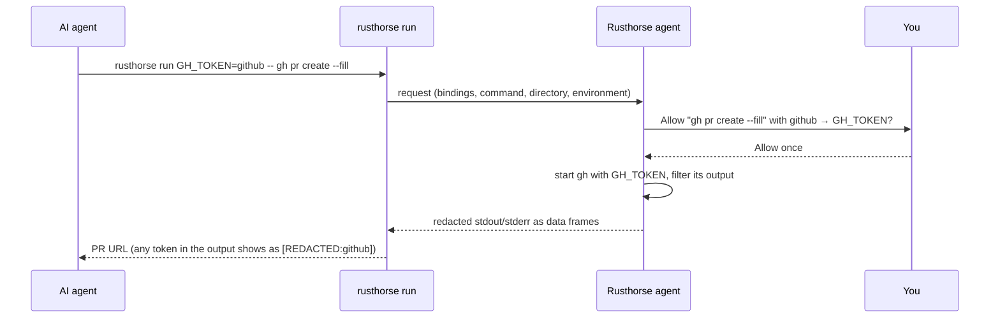

# Using Rusthorse with AI agents

Rusthorse was built for one situation in particular: an AI coding agent
(Claude Code, Codex, Aider, an MCP tool, …) runs commands in your shell and
needs a credential to do its job. This guide shows how to set that up and how
to approve requests safely.

## The idea in one picture



The AI composes the command; you decide whether it runs; the secret goes
from the vault straight into the approved program.

## Setting up an agent

1. Store the secrets the agent will need, with names it can use directly:

   ```sh
   rusthorse add ANTHROPIC_API_KEY --kind api-key --url https://api.anthropic.com --tag ai
   rusthorse add github --kind login --username me --url https://github.com --tag dev
   rusthorse add core-router --kind device --username admin --url https://10.0.0.1/ --host 10.0.0.1 --tag network
   ```

   The [kind](cli.md#entry-kinds) tells the agent what each entry is; for an
   API key, `--url` is the API's endpoint, which the agent can pass to a
   program with `rusthorse run --url` (it is not a secret).

2. Tell the agent how to use them. Put this in `CLAUDE.md`, `AGENTS.md` or the
   equivalent instructions file:

   ```markdown
   ## Secrets
   - Secrets live in Rusthorse. Before you use one, run `rusthorse guide ai`
     and follow it.
   - Never ask for, print or write secret values, and never use
     `rusthorse reveal`. If a request is denied, or nobody answers the
     dialog in time, stop and ask the human.
   ```

   `rusthorse guide ai` prints the guide built into the installed `rusthorse`:
   the rules above and why, how to find entries (`list --kind`,
   `show NAME --json` for the host and username), how to use `run`
   (`VAR=NAME`, `--broker`, `--url`, quoting, input, redaction), what each
   exit status means and what to do about it, and how to store secrets without
   seeing them (`add`, `--generate`, `import dotenv`). A test checks that
   every command and option it names exists, so it changes with the CLI and
   the instructions file does not have to. Its source is
   [src/guide/ai.md](../src/guide/ai.md). The snippet repeats the most
   important rules, so that they apply even before the agent has read the
   guide.

3. Keep `rusthorse agent` running under systemd (see
   [installation.md](installation.md)). Never let the AI start the agent.

4. Ask the AI to run `rusthorse doctor`. This checks, from the AI's own shell,
   that it finds `rusthorse` (if not, see
   [installation.md](installation.md#from-source)) and reaches the
   agent.

## HTTP APIs through the credential broker

Prefer `run --broker` when the entry has a usable profile and the operation
fits its routes. You set the profile in an edit the agent asks you to approve:

```sh
rusthorse edit ANTHROPIC_API_KEY --broker anthropic
rusthorse edit OPENAI_API_KEY --broker openai
rusthorse edit DEEPSEEK_API_KEY --broker openai-compatible --broker-origin https://api.deepseek.com
```

The program must use the token and the broker's base URL together:

```sh
env -u ANTHROPIC_AUTH_TOKEN rusthorse run \
  --broker ANTHROPIC_API_KEY --url ANTHROPIC_BASE_URL=ANTHROPIC_API_KEY -- python app.py
rusthorse run --broker OPENAI_API_KEY --url OPENAI_BASE_URL=OPENAI_API_KEY -- python app.py
rusthorse run --broker OPENAI_API_KEY=DEEPSEEK_API_KEY --url OPENAI_BASE_URL=DEEPSEEK_API_KEY -- python app.py
```

These are recipes for programs that read those variables, not a claim that
every SDK does. The Anthropic preset accepts either `x-api-key` or
`Authorization: Bearer`; if both appear they must both hold the grant's token.
Leave competing key variables out, and check SDK configuration that may
override the environment. Use the same entry spelling for `--broker` and
`--url`. Never send the token to the provider's own URL or fall back to an
ordinary value binding after a broker refusal.

Claude Code is interactive and uses the terminal through `--no-redact`; the
[built-in guide](../src/guide/ai.md#claude-code-through-the-broker) gives its
separate recipe and settings checks. The manual check with a real key (ADR
0013, answer 9) began on 2026-11-04: the Anthropic Python SDK 2.4.0 worked
through the broker for the requests tried; Claude Code's requests went
through it, and the API answered them `400`, as it answered SDK requests
with some of Claude Code's parameters sent with the key by value, so no
Claude Code answer through the broker has been seen yet. If Claude Code
shows `Credit balance is too low` while other requests with the same key
work, the account refuses Claude Code's requests (with the key used in
that test, its beta `claude-code-20250219` alone drew that answer, with or
without the broker): check the account, not Rusthorse. No client version
is called supported yet. You approve each use; the automated
tests use fake destinations and keys only.

A grant is approved once, with no `--remember`. Each admitted request,
including a retry, consumes one use; a stream holds a slot until it ends.
Disable SDK retries where practical, and impose spending limits at the
provider: a request count cannot bound the cost of one request.

When the destination does not accept the key stored in the entry, it answers
`401 Unauthorized`, and the program sees that answer as it came, which can
read like a problem with its token. `rusthorse run` then says, after the
command, which entry's key the destination refused and how to replace it
(`rusthorse edit NAME --value`, where you type the new key in a dialog);
`rusthorse grants` and the Grants page show the count while the command runs.
The JSON errors the broker writes itself start their message with
`rusthorse-broker:`.

Inspect `rusthorse grants` or the manager's Grants page, and end one with
`rusthorse grants revoke ID` or all with `rusthorse grants revoke --all`.
Explicit `rusthorse lock` also ends them all. AI profiles default to
`automatic_locks: continue` and 12 hours, so screen lock, suspend or idle lock
can leave active grants running. Choose `end` or a shorter lifetime for
profiles that should stop sooner. Entry changes, failed saves, command end,
broker failure and expiry also end grants. Already-sent requests may still
take effect even after revocation has been confirmed.

With zenity, two or more grants in one approval may exceed its estimated
height and be refused. `rusthorse-dialog` scrolls; both retain character
limits and never truncate what is approved.

## Approving requests

The dialog is where your security comes from. Before clicking **Allow**, read
these lines:

| Line | Ask yourself |
|---|---|
| **Command** | Is this what I expected the agent to do right now? Does it send data anywhere (`curl`, `nc`, `ssh`, `git push`)? |
| **Program** | Is this the real tool (`/usr/bin/gh`), or something in a project or temporary directory? |
| **Directory** | Is the agent working where I think it is? |
| **Broker grants** | Is the destination correct, is every route needed, and are the lifetime, automatic-lock policy, request count and concurrency acceptable? The dialog warns that bodies are opaque and calls can spend credit. Mixed runs still deliver real values for ordinary bindings. |
| **Secrets** | Does this command need *these* secrets? An API key for a model has no business in `git push`. |
| **Requested by (unverified)** | Is it the AI's shell, or something unexpected? These are process names, which any program can choose, so they inform but do not prove who asked. |
| **Destinations (environment)** | Is every host one you expect — the provider's real API, your own database? An AI agent can set `OPENAI_BASE_URL` or `DATABASE_URL` to a server of its own, and the approved program would send the secret there. |
| **Warnings** | `NODE_OPTIONS`, `PYTHONPATH`, `GIT_SSH_COMMAND` and similar can make the program run other code. A proxy (`HTTPS_PROXY`) or a certificate variable (`SSL_CERT_FILE`, `NODE_TLS_REJECT_UNAUTHORIZED`) lets someone else see or redirect its connections. Deny unless you know why they are set. |

A `\u{…}` in a dialog stands for a character Rusthorse does not draw as
itself — a line break, an invisible or combining character, a letter of
another script, an emoji. `\u{a}` is a line break. The request may also
contain those six characters literally, which looks the same: take any
`\u{…}` for the character it names, and look closer at anything unexpected
before you allow it.

Be especially careful with:

- **Shell one-liners** (`sh -c '…'`, `bash -c '…'`). Everything inside runs
  with the ordinary values or broker capabilities you grant. Read the whole
  string.
- **Scripts in the project** (`python deploy.py`, `./run.sh`, `npm run x`).
  You are approving whatever the file contains *now*, and the AI can edit
  files. If it just changed the script, look at the change first.
- **Interpreters with an inline program** (`python -c`, `node -e`).
- **`--no-redact`**. The output will contain the secret if the program prints
  it (a token for a broker binding).

**Remembered approvals** ("Allow for N") are off by default. If you enable
them (`rusthorse agent --remember 5m`), they skip the dialog for *identical*
requests — same command line, program, directory, secrets, environment and
vault state — but not for what the command reads: an agent can change a
script, a config file or the command's input between runs. Enable them only
for commands whose inputs you control, and use `rusthorse lock` when you step
away. Remembering never applies to `broker_run`.

**Sandboxed agents.** If the AI agent runs in a sandbox (restricted network,
read-only file system, container), remember that the command you approve is
started by Rusthorse *outside* that sandbox, with your full access. The
dialog says so on the "Runs" line.

When something looks wrong, click **Deny**. The command does not run, the AI
gets exit status 125, and the denial is in `rusthorse audit`.

## What this protects against — and what it does not

Rusthorse is effective against the problems that actually happen with
cooperative-but-fallible agents:

- the secret never appears in the conversation, the agent's context window,
  its transcripts or its tool logs;
- the agent cannot quietly use a credential for something you did not see;
- output that happens to contain the secret is redacted;
- there is a record of every use.

For ordinary bindings, default redaction catches literal copies on
stdout/stderr; encodings, files and network writes can bypass it (L5). For
each broker binding the command instead receives a token, never the source
credential. The broker fixes the credential's destination and routes, and
redacts literal copies returned in response bodies. A grant is a capability
you approve once: allowed calls can spend credit or access data without
another dialog. Each admission is recorded before forwarding; completion
records are best effort and abrupt process death can leave an unfinished audit
trail.

It cannot make a malicious agent harmless when the agent runs as you in your
desktop session. An agent that is actively trying to steal a secret can get it
— by encoding it in an approved command's output, by having a script send it
somewhere, by reading `/proc/<pid>/environ` of a running command (a value for
an ordinary binding, a token for a broker binding), or on X11 by clicking
"Allow" itself. Rusthorse makes such attempts visible and leaves a trail; it
does not detect them for you. To resist a hostile agent, run it isolated from
your session (separate user, no access to your display or processes) — see
[threat model §8](threat-model.md#8-running-ai-agents-in-isolation).

A stolen broker token works through its listener within the grant's routes and
limits until it ends. The loopback hop is clear text HTTP; request bodies are
not inspected, and transformed copies of a credential returned by the
destination escape literal redaction. `--no-redact` exposes anything the
command prints, including tokens. See L21–L24 of the
[threat model](threat-model.md) for these broker-specific limits.

## Tips

- Use separate, narrowly scoped credentials for agents (a fine-grained GitHub
  token for one repository, a model API key with a spending limit) so that a
  mistake costs little.
- Prefer tools that read credentials from environment variables
  (`GH_TOKEN`, `PGPASSWORD`, `AWS_*`, `OPENAI_API_KEY`) over ones that need
  them on the command line: command lines are visible to other processes.
- Review `rusthorse audit` now and then.
