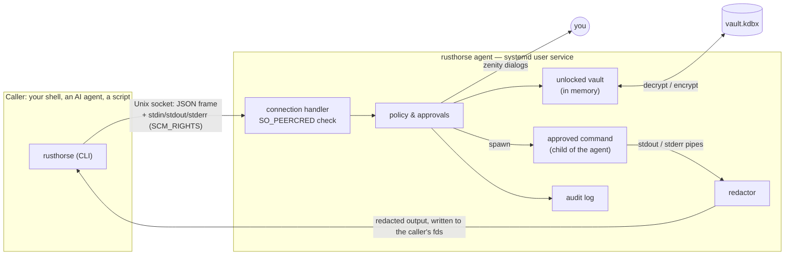
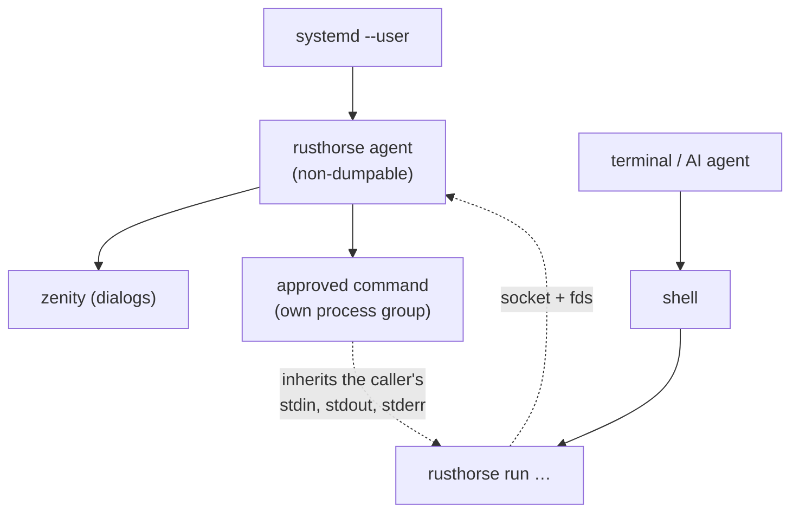

# Architecture

This document explains how Rusthorse is put together: the components, how a
request flows through them, how data is stored, and where each part lives in
the code. Security reasoning is in the [threat model](threat-model.md); the
wire format is in [protocol.md](protocol.md).

## Overview



There are two programs in one binary:

- **The agent** (`rusthorse agent`) runs for the whole desktop session. It is
  the only component that decrypts the vault, sees secret values, shows
  dialogs and starts approved commands.
- **The CLI** (every other subcommand) is a thin client. It turns command-line
  arguments into one request, sends it over the socket, prints the response
  and exits. It never handles the master password, and for `run` it never
  handles secret values.

## Process model



- The agent is started by systemd, so it is **not** a descendant of the
  caller. Linux (with Yama `ptrace_scope=1`, the default on Ubuntu and Mint)
  only lets a process inspect its own descendants, and the agent also marks
  itself non-dumpable (`PR_SET_DUMPABLE=0`), which blocks inspection by any
  other process of the same user and disables core dumps.
- Approved commands are children of the agent, in their own process group.
  The caller's shell cannot attach to them with a debugger either.
- Dialogs are separate `zenity` processes started by the agent. The caller
  cannot answer them through its terminal.

## Lifecycle of a `run` request

```mermaid
sequenceDiagram
    autonumber
    participant C as rusthorse run (caller)
    participant A as agent
    participant Z as zenity
    participant X as approved command

    C->>A: connect; Run{bindings, argv, cwd, env, redact} + fds 0,1,2
    A->>A: SO_PEERCRED: same uid? read process chain
    alt vault locked
        A->>Z: master password dialog
        Z-->>A: password
        A->>A: decrypt vault.kdbx (Argon2id)
    end
    A->>A: check entries exist, resolve program, clean environment
    alt identical request approved "for a while"
        A->>A: use remembered approval
    else
        A->>Z: approval dialog (command, program, directory, secrets, requester, warnings)
        Z-->>A: Allow once / Allow for 10m / Deny
    end
    A->>A: audit record (fail closed)
    A->>X: spawn with env + secrets, stdin = caller's fd 0, stdout/stderr = pipes
    loop while running
        X-->>A: output
        A-->>C: redacted output, written straight to the caller's fds 1 and 2
    end
    X-->>A: exit status
    A->>A: audit record (exit status)
    A-->>C: Exited{code, signal}
    C->>C: exit with the same status
```

If the caller disconnects (for example it is killed or interrupted) before
the command finishes, the agent sends `SIGTERM` to the command's process group
and `SIGKILL` three seconds later.

## Policy

| Request | Unlock needed | Human interaction | Remembered |
|---|---|---|---|
| `status`, `lock` | no | none | — |
| `unlock` | — | master password dialog | — |
| `list`, `show` | yes | none — metadata only | — |
| `add` (value typed by you) | yes | value dialog | — |
| `add --stdin` | yes | approval | no |
| `import` | yes | one approval for the batch | no |
| `edit` | yes | approval (+ value dialog with `--value`) | no |
| `remove` | yes | approval | no |
| `reveal` | yes | approval with a warning | no |
| `run` | yes | approval | optional, exact match |

"Metadata" is the entry name, group, username, URL, host, port, tags, whether
a value and notes exist, the *names* of other fields and the modification
time. Values, notes and the values of other fields are never sent without
approval.

### Remembered approvals

"Allow for 10m" stores, in memory only, a key made of the exact bindings,
command line, canonical program path, working directory, redaction flag and
the names and values of risky environment variables. A later request is
approved without a dialog only if its key is identical and the time has not
expired. `lock` (manual or automatic) forgets every remembered approval.
Requests whose command line is too long to display in full are never
remembered.

### Locking

The decrypted vault is dropped after `--idle-timeout` (default 15 minutes)
without requests, on `rusthorse lock`, and when the agent stops. A command
that is already running keeps the secrets it was given.

## Storage format

The vault is a standard KeePass **KDBX 4** file, written with the
[`keepass`](https://crates.io/crates/keepass) crate:

- Outer encryption AES-256, inner stream ChaCha20, GZip compression.
- Key derivation for new vaults: Argon2id, 64 MiB, 20 passes, 2 lanes
  (about 0.7 s per unlock on a desktop CPU). Existing files keep their own
  parameters.

### Field mapping

| Rusthorse | KDBX field | Protected in the file | Returned without approval |
|---|---|---|---|
| name | `Title` | no | yes |
| username | `UserName` | no | yes |
| value | `Password` | yes | **no** |
| url | `URL` | no | yes |
| host | `Host` (custom) | no | yes |
| port | `Port` (custom) | no | yes |
| notes | `Notes` | yes | **no** |
| tags | `Tags` | — | yes |
| group | entry's group path | — | yes |
| other fields | custom fields | as stored | names only |

Entries in the recycle bin are ignored. Edits record the previous state in
the entry's KeePass history, so KeePassXC can show and restore old versions.

### Saving

Every change is saved immediately:

1. The new database is written to a temporary file in the same directory
   (mode `0600`) and `fsync`ed.
2. The current file is hard-linked to `vault.kdbx.bak`.
3. The temporary file is renamed over `vault.kdbx` (atomic) and the directory
   is `fsync`ed.

Before step 1 the agent compares the file's device, inode, size and
modification time with what it loaded. If another program (KeePassXC, a sync
client) changed the file, the save is refused with `vault_changed` instead of
silently discarding those changes; locking and unlocking reloads the file.

## Concurrency

The agent accepts connections on one thread and handles each connection on
its own thread; a connection carries exactly one request. Shared state (the
vault, the last-use time and remembered approvals) sits behind one mutex that
is never held while a dialog is open or a command is running. A second mutex
serializes dialogs, so you are asked one question at a time. A background
thread checks the idle timeout every second.

## Audit log

Each decision appends one JSON object to `audit.jsonl`: time, action, outcome,
entry names, requester chain and, for `run`, the command line and directory.
Values are never logged. If a record cannot be written, approval-gated
requests are refused ("fail closed"). See [cli.md](cli.md#rusthorse-audit).

## Code map

| Module | Responsibility |
|---|---|
| [`src/main.rs`](../src/main.rs) | Command-line parsing and output formatting. |
| [`src/agent.rs`](../src/agent.rs) | The agent: socket server, policy, unlock, approvals, `run`. |
| [`src/vault.rs`](../src/vault.rs) | KDBX4 access, field mapping, atomic saves. |
| [`src/protocol.rs`](../src/protocol.rs) | Request and response types, framing, fd passing. |
| [`src/client.rs`](../src/client.rs) | Client side of the protocol. |
| [`src/ui.rs`](../src/ui.rs) | The `Ui` trait and the zenity implementation. |
| [`src/exec.rs`](../src/exec.rs) | Program resolution and environment cleaning for `run`. |
| [`src/redact.rs`](../src/redact.rs) | Streaming redaction of secret values. |
| [`src/peer.rs`](../src/peer.rs) | Peer credentials and the requester process chain. |
| [`src/audit.rs`](../src/audit.rs) | The audit log. |
| [`src/import.rs`](../src/import.rs) | `.env` and Secret Service importers. |
| [`src/paths.rs`](../src/paths.rs), [`src/util.rs`](../src/util.rs) | Locations and helpers. |
| [`tests/agent.rs`](../tests/agent.rs) | End-to-end tests against a real agent. |

## Design decisions

The reasoning behind the main choices is recorded as
[architecture decision records](adr/README.md):

- [ADR 0001](adr/0001-kdbx4-storage.md) — KeePass KDBX4 as the storage format
- [ADR 0002](adr/0002-agent-mediated-execution.md) — the agent, not the client, runs approved commands
- [ADR 0003](adr/0003-agent-side-dialogs.md) — approvals are dialogs shown by the agent
- [ADR 0004](adr/0004-native-distribution.md) — native binary and systemd, no Flatpak
