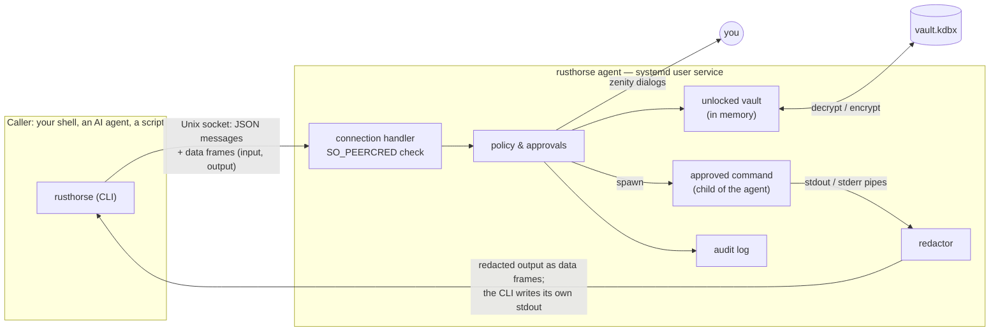
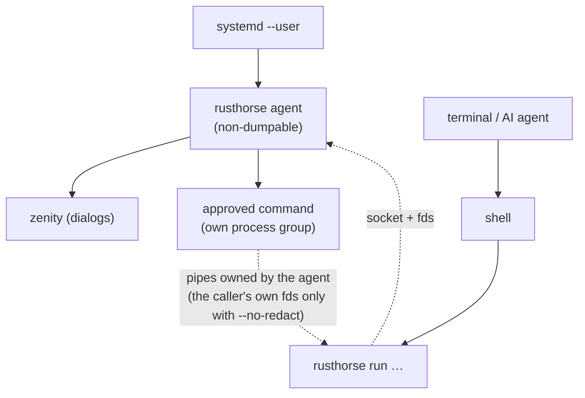

# Architecture

This document explains how Rusthorse is put together: the components, how a
request flows through them, how data is stored, and where each part lives in
the code. Security reasoning is in the [threat model](threat-model.md); the
wire format is in [protocol.md](protocol.md).

## Overview



There are two programs in one binary:

- **The agent** (`rusthorse agent`) runs for the whole desktop session. It is
  the only component that decrypts the vault, sees secret values, shows
  dialogs and starts approved commands.
- **The CLI** (every other subcommand) is a thin client. It turns command-line
  arguments into one request, sends it over the socket, prints the response
  and exits. It never handles the master password, and for `run` it never
  handles secret values.

## Process model



- The agent is started by systemd, so it is **not** a descendant of the
  caller. Linux (with Yama `ptrace_scope=1`, the default on Ubuntu and Mint)
  only lets a process inspect its own descendants, and the agent also marks
  itself non-dumpable (`PR_SET_DUMPABLE=0`), which blocks inspection by any
  other process of the same user and disables core dumps.
- Approved commands are children of the agent, in their own process group.
  The caller's shell cannot attach to them with a debugger either.
- Dialogs are separate `zenity` processes started by the agent. The caller
  cannot answer them through its terminal.

## Lifecycle of a `run` request

```mermaid
sequenceDiagram
    autonumber
    participant C as rusthorse run (caller)
    participant A as agent
    participant Z as zenity
    participant X as approved command

    C->>A: connect; Run{bindings, argv, cwd, env, redact} (fds 0,1,2 only with --no-redact)
    A->>A: SO_PEERCRED: same uid? read process chain
    alt vault locked
        A->>Z: master password dialog
        Z-->>A: password
        A->>A: decrypt vault.kdbx (Argon2id)
    end
    A->>A: check entries exist (UUIDs), resolve program, clean environment,<br/>refuse details too long to show
    alt remembering enabled and an identical request was approved
        A->>A: use remembered approval
    else
        A->>Z: approval dialog (command, program, directory, secrets, requester, warnings)
        Z-->>A: Allow once / Deny (/ Allow for N, if enabled) — via a socket pair
    end
    A->>A: audit record (fail closed)
    A->>A: re-check: same vault generation? same program and directory inodes? same entries?
    A->>X: spawn with env + secrets; stdout, stderr = agent-owned pipes;<br/>stdin = /dev/null (or a pipe with --stdin)
    loop while running
        opt run --stdin
            C-->>A: the CLI reads its own stdin and sends it as data frames
        end
        X-->>A: output
        A-->>C: redacted output as data frames; the CLI writes it to its stdout/stderr
    end
    X-->>A: exit (not yet reaped)
    A->>A: terminate what is left of its process group, join all workers, reap
    A->>A: audit record (exit status)
    A-->>C: Exited{code, signal}
    C->>C: exit with the same status
```

When the command exits, and also if the caller disconnects (for example it is
killed or interrupted) before that, the agent sends `SIGTERM` to whatever is
left of the command's process group and `SIGKILL` three seconds later.

The leader is reaped only afterwards, so its process group id cannot be
reused by an unrelated process while it is being signalled. A process whose
main thread has exited while other threads still run counts as alive.

With redaction, the agent never touches the caller's own descriptors. It
sends the redacted output over the connection as data frames, and the
`rusthorse run` process writes them to its stdout and stderr (and, with
`--stdin`, reads its own stdin and sends it on). Output is delivered like in a
pipeline: while the caller stays connected, the agent waits for it to read,
however slowly. `rusthorse run` writes each channel on its own thread and
grants the agent credit per channel as it writes, so a stuck stdout does not
hold up stderr (each channel has a 1 MiB window). The only thing the agent
writes is its own socket. A full close, a half-close or a protocol violation
by the caller cancels the request: the agent shuts the socket down — which
fails any send in progress at once — and terminates the command. Input has
its own window too, so input that the command has not read yet never stops
the agent from reading the connection. If the caller's stdout is closed
(`| head`), `rusthorse run` shuts the connection down (through a handle that
needs no lock) and exits with status 141, like a process killed by
`SIGPIPE` — within about half a second, even if its other output is stuck.

## Policy

| Request | Unlock needed | Human interaction | Remembered |
|---|---|---|---|
| `status`, `lock` | no | none | — |
| `unlock` | — | master password dialog | — |
| `list`, `show` | yes | none — metadata only | — |
| `add` (value typed by you) | yes | value dialog | — |
| `add --stdin` | yes | approval | no |
| `import` | yes | one approval for the batch | no |
| `edit` | yes | approval (+ value dialog with `--value`) | no |
| `remove` | yes | approval | no |
| `reveal` | yes | approval with a warning | no |
| `run` | yes | approval | opt-in (`--remember`), exact match |

"Metadata" is the entry name, group, username, URL, host, port, tags, whether
a value and notes exist, the *names* of other fields and the modification
time. Values, notes and the values of other fields are never sent without
approval.

Fields that the KDBX file marks as *protected* (KeePassXC lets you protect
any field) are withheld from metadata as well; `protected_fields` lists their
names.

### Vault generation

The agent keeps a *generation* counter, incremented on every unlock, lock and
saved change. Every approval-gated request records the generation before it
asks the human and acts only if it is unchanged afterwards — checked under the
same lock that reads the values or applies the change — so a lock, edit or
removal that happens while a dialog is open cancels the request instead of
acting on stale information. An unlock records the generation before showing
the password dialog and is cancelled if a `lock` arrived meanwhile.

### Remembered approvals

Off by default ([ADR 0005](adr/0005-remembered-approvals-opt-in.md)). With
`--remember DURATION`, "Allow for DURATION" stores, in memory only, a key made
of the vault generation, the bindings and entry UUIDs, the exact command line,
canonical program path, working directory, redaction and stdin-forwarding
flags and the complete effective environment (sorted by name, as the command
receives it). A later request is approved without a
dialog only if its key is identical and the time has not expired; any change
to the vault therefore invalidates it. Requests whose details are too long to
display in full are refused outright.

### Locking

The decrypted vault is dropped after `--idle-timeout` (default 15 minutes)
without an *approved* use (`status`, `list`, `show` and denied requests do
not count), on `rusthorse lock`, when a save fails, and when the agent stops.
A command that is already running keeps the secrets it was given.

## Storage format

The vault is a standard KeePass **KDBX 4** file, written with the
[`keepass`](https://crates.io/crates/keepass) crate:

- Outer encryption AES-256, inner stream ChaCha20, GZip compression.
- Key derivation for new vaults: Argon2id, 64 MiB, 20 passes, 2 lanes
  (about 0.7 s per unlock on a desktop CPU). Existing files keep their own
  parameters.

### Field mapping

| Rusthorse | KDBX field | Protected in the file | Returned without approval |
|---|---|---|---|
| name | `Title` | no | yes |
| username | `UserName` | no | yes |
| value | `Password` | yes | **no** |
| url | `URL` | no | yes |
| host | `Host` (custom) | no | yes |
| port | `Port` (custom) | no | yes |
| notes | `Notes` | yes | **no** |
| tags | `Tags` | — | yes |
| group | entry's group path | — | yes |
| other fields | custom fields | as stored | names only |

Entries in the recycle bin are ignored. Edits record the previous state in
the entry's KeePass history, so KeePassXC can show and restore old versions.

### Saving

Every change is saved immediately:

1. The new database is written to a temporary file in the same directory
   (mode `0600`) and `fsync`ed.
2. The current file is hard-linked to `vault.kdbx.bak`.
3. The temporary file is renamed over `vault.kdbx` (atomic) and the directory
   is `fsync`ed.

Before step 1, and again just before step 3, the agent compares the file's
device, inode, size and modification time with what it loaded. If another
program (KeePassXC, a sync client) changed the file, the save is refused with
`vault_changed` instead of silently discarding those changes; locking and
unlocking reloads the file. The two checks narrow the window but are not an
atomic compare-and-swap, so only one program should write the vault at a time
(threat model L15). Every change is a transaction on an in-memory copy: if any
part of it fails (one invalid entry in an import, say), all of it is rolled
back. If the save itself fails, the agent locks the vault so that memory never
holds changes that are not on disk.

Deleted entries are recorded in the KDBX `DeletedObjects` list, so that
merging with an older copy does not bring them back. Vault files larger than
128 MiB are refused before anything is decrypted.

## Concurrency

The agent accepts connections on one thread and handles each connection on
its own thread; a connection carries exactly one request, which must arrive
within 10 seconds. At most 64 connections are handled at once and at most 8
requests may wait for a dialog; more are refused. Shared state (the vault,
the generation, the last-use time and remembered approvals) sits behind one
mutex that is never held while a dialog is open or a command is running. A
second mutex serializes dialogs, so you are asked one question at a time. A
background thread checks the idle timeout every second.

### Dialogs

zenity is run from `/usr/bin` (or `/usr/local/bin`), never through `PATH`,
with `/` as its working directory and only the display, locale and D-Bus
variables in its environment. Its answer is read from a socket pair rather
than a pipe, because other processes of the same user can open a pipe through
`/proc/<pid>/fd` but not a socket. Text for the entry dialog has backslashes
and underscores escaped; the question dialog uses `--no-markup`. Only an exit
status of 0 with no output (Allow once), or 1 with the exact label of the
extra button (Allow for N), counts as approval. A request whose dialog text
would exceed 4000 characters — counting the room reserved for the "Allow
for" note — is refused rather than shown truncated.

## Audit log

Each decision appends one JSON object to `audit.jsonl`: time, action, outcome,
entry names, requester chain and, for `run`, the command line and directory.
Values are never logged. If a record cannot be written, approval-gated
requests are refused ("fail closed"). See [cli.md](cli.md#rusthorse-audit).

## Code map

| Module | Responsibility |
|---|---|
| [`src/main.rs`](../src/main.rs) | Command-line parsing and output formatting. |
| [`src/agent.rs`](../src/agent.rs) | The agent: socket server, policy, unlock, approvals, `run`. |
| [`src/vault.rs`](../src/vault.rs) | KDBX4 access, field mapping, atomic saves. |
| [`src/protocol.rs`](../src/protocol.rs) | Request and response types, framing, fd passing. |
| [`src/client.rs`](../src/client.rs) | Client side of the protocol; relays a `run`'s input and output. |
| [`src/ui.rs`](../src/ui.rs) | The `Ui` trait and the zenity implementation. |
| [`src/exec.rs`](../src/exec.rs) | Program resolution and environment cleaning for `run`. |
| [`src/redact.rs`](../src/redact.rs) | Streaming redaction of secret values. |
| [`src/peer.rs`](../src/peer.rs) | Peer credentials and the requester process chain. |
| [`src/audit.rs`](../src/audit.rs) | The audit log. |
| [`src/import.rs`](../src/import.rs) | `.env` and Secret Service importers. |
| [`src/paths.rs`](../src/paths.rs), [`src/util.rs`](../src/util.rs) | Locations and helpers. |
| [`tests/agent.rs`](../tests/agent.rs) | End-to-end tests against a real agent. |

## Design decisions

The reasoning behind the main choices is recorded as
[architecture decision records](adr/README.md):

- [ADR 0001](adr/0001-kdbx4-storage.md) — KeePass KDBX4 as the storage format
- [ADR 0002](adr/0002-agent-mediated-execution.md) — the agent, not the client, runs approved commands
- [ADR 0003](adr/0003-agent-side-dialogs.md) — approvals are dialogs shown by the agent
- [ADR 0004](adr/0004-native-distribution.md) — native binary and systemd, no Flatpak
- [ADR 0005](adr/0005-remembered-approvals-opt-in.md) — remembered approvals are opt-in
