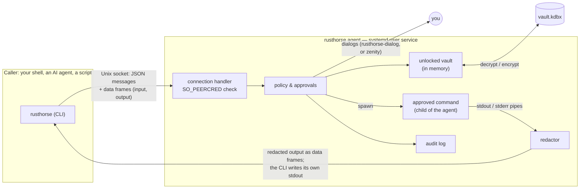
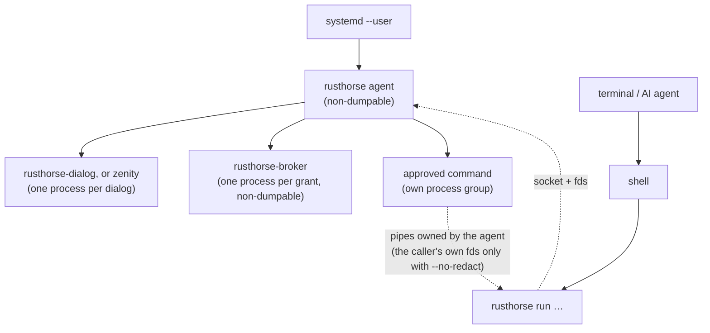

# Architecture

This document explains how Rusthorse is put together: the components, how a
request flows through them, how data is stored, and where each part lives in
the code. Security reasoning is in the [threat model](threat-model.md); the
wire format is in [protocol.md](protocol.md).

## Overview



The CLI and agent share a binary; the dialog, manager and credential broker
are optional separate programs:

- **The agent** (`rusthorse agent`) runs for the whole desktop session. It is
  the only component that decrypts the vault, holds the decrypted database,
  shows approval/secret-entry dialogs and starts approved commands. An
  approved `reveal` also sends one value to its client.
- **The CLI** (every other subcommand) is a thin client. It turns command-line
  arguments into one request, sends it over the socket, prints the response
  and exits. For `run` it receives no values from the vault. It holds a value
  only when supplied by the user or requested through `reveal`; `init` without
  an agent handles the new master password locally.
- **`rusthorse-manager`** (GTK 4 and libadwaita, built separately) is a
  window to manage entries: a client of the agent like the CLI, which shows
  or copies a value only through an approved `reveal`. It never opens the
  vault or asks for a master password. See [Visual manager](#visual-manager).
- **`rusthorse-dialog`** (GTK 4 and libadwaita, built separately) shows one
  dialog for the agent and exits. Without it, the agent uses zenity.

- **`rusthorse-broker`** is one process per HTTP grant. It receives only that
  grant's credential, token, profile and limits, not the vault or master
  password. It authenticates requests to the profile's HTTPS destination and
  relays responses; the agent owns approval, accounting and revocation.

## Process model



- The agent is started by systemd, so it is **not** a descendant of the
  caller. Linux (with Yama `ptrace_scope=1`, the default on Ubuntu and Mint)
  only lets a process inspect its own descendants, and the agent also marks
  itself non-dumpable (`PR_SET_DUMPABLE=0`), which blocks inspection by any
  other process of the same user and disables core dumps.
- Approved commands are children of the agent, in their own process group.
  The caller's shell cannot attach to them with a debugger either.
- Dialogs are separate processes started by the agent — `rusthorse-dialog`,
  or zenity when it is not installed. The caller cannot answer them through
  its terminal.

## Lifecycle of a `run` request

```mermaid
sequenceDiagram
    autonumber
    participant C as rusthorse run (caller)
    participant A as agent
    participant Z as dialog
    participant X as approved command

    C->>A: connect; Run{bindings, argv, cwd, env, redact} (fds 0,1,2 only with --no-redact)
    A->>A: SO_PEERCRED: same uid? read process chain
    alt vault locked
        A->>Z: master password dialog
        Z-->>A: password
        A->>A: decrypt vault.kdbx (Argon2id)
    end
    A->>A: check entries exist (UUIDs), resolve program, clean environment,<br/>refuse details too long to show
    alt remembering enabled and an identical request was approved
        A->>A: use remembered approval
    else
        A->>Z: approval dialog (command, program, directory, secrets, requester,<br/>where it connects, warnings)
        Z-->>A: Allow once / Deny (/ Allow for N, if enabled) — via a socket pair
    end
    A->>A: audit record (fail closed)
    A->>A: re-check: same vault generation? same program and directory inodes? same entries?
    A->>X: spawn with env + secrets; stdout, stderr = agent-owned pipes;<br/>stdin = /dev/null (or a pipe with --stdin)
    loop while running
        opt run --stdin
            C-->>A: the CLI reads its own stdin and sends it as data frames
        end
        X-->>A: output
        A-->>C: redacted output as data frames; the CLI writes it to its stdout/stderr
    end
    X-->>A: exit (not yet reaped)
    A->>A: terminate what is left of its process group, join all workers, reap
    A->>A: audit record (exit status)
    A-->>C: Exited{code, signal}
    C->>C: exit with the same status
```

Cleaning the environment (`exec::prepare_env`) removes `LD_*` variables and
sorts the others the dialog must show: variables that can make the program
run other code (`RISKY_VARS`), variables that name where it connects
(`exec::destination`: `*_URL`, `*_HOST`, …, shown under "Destinations") and
variables that route its connections or change which servers it trusts
(proxies, certificate authorities, shown as a warning). A later duplicate
replaces an earlier one, as in the command's environment. Destination values
are shortened for the dialog and the audit record (`shown_destination`:
scheme, host and port of a URL, item by item in a list variable such as
`GOPROXY`, split as its program splits it); a value without an
unambiguous form is replaced by `(not shown)` and named in a warning. The
command gets the values unchanged.

When the command exits, and also if the caller disconnects (for example it is
killed or interrupted) before that, the agent sends `SIGTERM` to whatever is
left of the command's process group and `SIGKILL` three seconds later.

The leader is reaped only afterwards, so its process group id cannot be
reused by an unrelated process while it is being signalled. A process whose
main thread has exited while other threads still run counts as alive.

With redaction, the agent never touches the caller's own descriptors. It
sends the redacted output over the connection as data frames, and the
`rusthorse run` process writes them to its stdout and stderr (and, with
`--stdin`, reads its own stdin and sends it on). Output is delivered like in a
pipeline: while the caller stays connected, the agent waits for it to read,
however slowly. `rusthorse run` writes each channel on its own thread and
grants the agent credit per channel as it writes, so a stuck stdout does not
hold up stderr (each channel has a 1 MiB window). The only thing the agent
writes is its own socket. A full close, a half-close or a protocol violation
by the caller cancels the request: the agent shuts the socket down — which
fails any send in progress at once — and terminates the command. Input has
its own window too, so input that the command has not read yet never stops
the agent from reading the connection. If the caller's stdout is closed
(`| head`), `rusthorse run` shuts the connection down (through a handle that
needs no lock) and exits with status 141, like a process killed by
`SIGPIPE` — within about half a second, even if its other output is stuck.

## Lifecycle of a `broker_run`

The CLI sends a distinct protocol-8 request with entry names and variable
names, never a token, source key or requester-selected profile. It pairs a
`--url` with the broker binding by the same entry spelling; an alias that
would instead expose the entry's provider URL is refused. The agent resolves
UUIDs and the stored profiles and rejects duplicate brokered entries, mixed
use of the same entry, invalid variables, unusable profiles and credentials
outside 8–4096 visible ASCII characters. The helper's availability and room
for the grants are checked even before unlocking; no grant is served if the
agent's expiry thread could not start.

The approval shows each destination, every allowed route, termination policy,
maximum lifetime, request count (or no limit), concurrency, bindings by value
in a mixed run, command, program, directory and requester. It warns about
spending credit, opaque request bodies and unredacted output when requested.
Broker approvals are never remembered. All dialog parts pass `dialog_text` and
the size checks; no part is truncated. A single ordinary AI grant fits the
tested zenity height estimate, but two or more may exceed it and be refused;
`rusthorse-dialog` scrolls, subject to the text limits.

Preparation is one transaction:

1. Record approval, then under the agent's state lock check the generation,
   read the credentials and enter all grants as `starting`. Lock order is
   state then registry; admission never acquires the vault-state lock.
2. Record each grant's creation durably, bind its loopback port and start its
   broker. As soon as the process exists, register its control channel and
   process handle. Under that same registry lock, check `starting` and send
   `Install` non-blockingly. A revocation before this sends no credential; a
   revocation after it contains the registered broker even before `Ready`. A
   send that cannot complete fails preparation closed.
3. Wait at most 10 seconds for installation and readiness. The broker hardens
   itself before reading, validates the install and listening fd, parses the
   CA bundle, initializes TLS and registers sockets before answering `Ready`.
4. Under the registry lock require every grant to remain `starting`, then
   activate them together and start the command. Failure ends all grants,
   stops their brokers and releases the ports before a did-not-run answer.
   Cleanup also precedes a best-effort `aborted` audit record.

The command gets one token per broker binding (`rh_` plus 64 lowercase hex
characters), and `http://127.0.0.1:PORT` plus the stored base path in its URL
variable. The agent replaces requester values for those variables and adds
`127.0.0.1` to `NO_PROXY` and `no_proxy`. This helps clients that honor those
variables; it does not force a client to use them. Other entries may still be
given by value. Default output redaction covers both values and tokens;
`--no-redact` passes the requester's three input/output descriptors through
and can expose a printed token.

### HTTP, admission and accounting

One broker owns one listener, one credential and one grant. The agent keeps a
duplicate listener until the command ends, preventing port reuse after broker
failure while that command might still use it. The broker runs with an empty
environment, cwd `/`, its own process group and a socket pair as stdin/stdout;
stderr is discarded. It is not an OS sandbox.

HTTP/1.1 is used on both hops; TLS 1.2/1.3, SNI from the profile and the fixed
ALPN offer `http/1.1` on the upstream hop. Each request uses a new TLS
connection. The broker rebuilds Host, length, identity encoding and the
credential header. Header allowlists, exact routes and query rules reject
requests outside the stored preset. Redirects and encoded responses are
refused; literal credentials in relayed bodies and headers are removed. SSE is
streamed through the redactor, which retains a small suffix needed to match a
credential split across chunks. Opaque request bodies are not inspected. See
the
[normative HTTP rules](adr/0013-credential-broker.md#requests-and-responses).

Declared bodies are limited to 16 MiB, with a 64 MiB per-broker reservation
budget before admission. The reservation is held by both the exchange until a
response head and the body bytes, including bytes Hyper retains for writing.
It returns only after both release it; kernel socket buffers are outside this
budget. At most 16 requests are in flight and 64 client connections open per
grant. DNS uses `getaddrinfo` on bounded blocking work: a lookup retains its
semaphore slot until it actually returns, even after its request timed out.
Public addresses are tried in order within one 10-second resolution/connect
deadline, without a second resolution. There is no Happy Eyeballs; a stalled
first address may consume the deadline.

The broker numbers admissions from 1. The agent's reader validates numbers and
routes, refuses invalid state/limits immediately, or reserves a use and slot
under the registry lock. A bounded per-grant queue (256 jobs) feeds an audit
thread, which durably records the admission, rechecks state and lifetime, then
answers exactly once. Only then is the body read and the request forwarded. An
admitted attempt spends its use regardless of its outcome; each SDK retry is
another attempt. `finished` frees its slot and queues its completion record. A
failed completion record revokes the grant.

### Ending grants and the unlock barrier

The registry distinguishes `starting`, `active`, `exhausted` and `revoked`.
Exhaustion stops new admissions and lets admitted requests finish. A normally
revoked broker stays alive until its command ends; its registry entry remains
listed and consumes the 16-slot cap. If the broker exits, the entry is removed
sooner, but the run keeps its copy of the listener until cleanup.
`status.grants` counts only starting, active and exhausted grants. Listing and
revocation work while locked, without a dialog.

Every grant ends on explicit lock, failed save, agent exit or its command's
end; entry changes, manual revocation, broker failure and expiry end the
grants they concern. Every automatic lock ends every starting grant. For
active/exhausted grants it follows `automatic_locks`: `end` or `continue`
(default for AI presets, with a 12-hour maximum). Broker traffic never
postpones the vault's idle lock.

Revocation is decided under the registry lock: no later admission succeeds.
The agent tells the brokers and immediately refuses admissions waiting for
audit, without waiting for the log. It allows 250 ms to send and one second
for confirmation, then kills and reaps an unresponsive broker. Concurrent
revocations wait for the same completed containment, not merely a requested
kill. A lock/edit/revocation is reported done only after every concerned
broker confirms or is gone. Requests already sent may still take effect; there
is a window between decision and containment. Suspend locking retains the
timing limitations of
[L20](threat-model.md#l20--locking-with-the-screen-depends-on-the-desktops-signals).

When the agent sees the command's leader exit or the requester disconnect, it
revokes before terminating the remaining process group or draining output.
Descendants outside that group may survive, but their token loses its grant.
Ports are released after the run's cleanup.

An agent timer checks expiry every second on `CLOCK_BOOTTIME`. The broker
independently watches its installed remaining lifetime on that clock,
rereading at intervals of at most one second while scheduled so suspension
counts, and checking again before forwarding and relaying response data.
Expiry closes existing work and drops the credential. The broker reports
`finished` but no unsolicited `revoked`; it confirms a later agent revoke. EOF
on the control channel exits immediately without waiting for DNS work. SIGTERM
of the agent normally causes this EOF (systemd also kills its cgroup), but
does not run the serve-loop `StopGrants` guard, so it does not produce
`agent_stopped` grant-end records.

For grants surviving automatic locks, the agent keeps a keyed fingerprint of
the encrypted file bytes last read or written, across locks. At unlock, under
the state lock it checks the generation, compares fingerprints and decides
`vault_changed` for all surviving grants when different or missing. It
releases the state lock, contains the brokers, writes the unlock record
outside that lock, then rechecks the generation before publishing the unlocked
vault and new fingerprint. A lock before the comparison cancels the attempt
and keeps the previous fingerprint; a subsequent valid unlock finds the
change. Once comparison decided revocation, a later lock cannot cancel it.
Failed unlocks retain the previous fingerprint; an agent save of another entry
updates it without revoking unrelated grants.

## Policy

| Request | Unlock needed | Human interaction | Remembered |
|---|---|---|---|
| `status`, `lock` | no | none | — |
| `unlock` | — | master password dialog | — |
| `list`, `show` | yes | none — metadata only | — |
| `add` (value typed by you) | yes | value dialog | — |
| `add --stdin` | yes | approval | no |
| `add --generate` | yes | approval (the agent generates the value) | no |
| `change_password` | yes | current and new password dialogs | no |
| `import` (values from the client) | yes | one approval for the batch | no |
| `keyring_items`, `dotenv_names` | no | approval (the requester learns labels, attributes or names) | no |
| `import_from` (values read by the agent) | yes | one approval for the batch, naming the source | no |
| `edit` | yes | approval (+ value dialog with `--value`) | no |
| `remove` | yes | approval | no |
| `reveal` | yes | approval with a warning; the dialog names the client's stated purpose (print, show, copy) | no |
| `run` | yes | approval | opt-in (`--remember`), exact match |
| `broker_run` | yes | approval of the whole grant scope | no |
| `broker_edit` | yes | approval of the resolved profile and other edits | no |
| `grants`, `revoke_grant` | no | none | — |

"Metadata" includes the usable broker profile, and is the entry name, group,
username, URL, host, port, tags, whether a value and notes exist, the *names*
of other fields and the modification time. Values, notes and the values of
other fields are never sent without approval.

Fields that the KDBX file marks as *protected* (KeePassXC lets you protect
any field) are withheld from metadata as well; `protected_fields` lists their
names.

### Vault generation

The agent keeps a *generation* counter, incremented on every unlock, lock and
saved change. Every approval-gated request records the generation before it
asks the human and acts only if it is unchanged afterwards — checked under the
same lock that reads the values or applies the change — so a lock, edit or
removal that happens while a dialog is open cancels the request instead of
acting on stale information. An unlock records the generation before showing
the password dialog and is cancelled if a `lock` arrived meanwhile.

### Remembered approvals

Off by default ([ADR 0005](adr/0005-remembered-approvals-opt-in.md)). With
`--remember DURATION`, "Allow for DURATION" stores, in memory only, a key made
of the vault generation, the bindings and entry UUIDs, the exact command line,
canonical program path, working directory, redaction and stdin-forwarding
flags and the complete effective environment (sorted by name, as the command
receives it). A later request is approved without a
dialog only if its key is identical and the time has not expired; any change
to the vault therefore invalidates it. Requests whose details are too long to
display in full are refused outright.

### Locking

The decrypted vault is dropped after `--idle-timeout` (default 15 minutes)
without an *approved* use (`status`, `list`, `show` and denied requests do not
count), on `rusthorse lock`, when a save fails, when the agent stops, and when
the session is locked or the computer is about to sleep. A command that is
already running keeps values it was given by ordinary bindings. Broker grants
instead obey the rules above; automatic locks can keep them alive.

The last two come from `session_lock`
([ADR 0009](adr/0009-lock-on-screen-lock-and-suspend.md)): three threads
(`zbus`, blocking API) watch logind's `PrepareForSleep` on the system bus —
holding a *delay* inhibitor, taken at start and after each resume and released
once the vault is locked, so that logind waits for the lock, up to its
`InhibitDelayMaxSec` —, logind's session `Lock` signal and `LockedHint` for
sessions of the agent's user, and the screensavers' `ActiveChanged` on the
session bus. Each reads signals on one connection and asks its questions (the
owner of logind's name, a session's user, the inhibitor — the last on a helper
thread) on a second one with a 2-second limit, so that a reply never waits
behind queued signals; the inhibitor never delays a lock, the other questions
by at most that limit. logind's signals count only from the current owner of
its name; malformed ones are ignored. A lock from them drops the vault and
changes the generation even when it is already locked, so an unlock under way
does nothing. Signals only lock; no signal unlocks. A watcher whose bus goes
away reports itself inactive in `status` and connects again every five
seconds; on connecting — and when a screensaver appears — it locks if a
session is locked or a screensaver on already, or if it gets no answer in
time. The inhibitor is let go only once the lock is done — never because
logind left or restarted (systemd keeps inhibitors across restarts); that only
changes `status`. The agent's handle on the watchers closes their connections
and waits up to 3 seconds for their threads when the agent is dropped. The
watchers exist only with the `session-lock` Cargo feature (on by default).

## Storage format

The vault is a standard KeePass **KDBX 4** file, written with the
[`keepass`](https://crates.io/crates/keepass) crate:

- Outer encryption AES-256, inner stream ChaCha20, GZip compression.
- Key derivation for new vaults: Argon2id, 64 MiB, 20 passes, 2 lanes
  (about 0.7 s per unlock on a desktop CPU). Existing files keep their own
  parameters.

### Field mapping

| Rusthorse | KDBX field | Protected in the file | Returned without approval |
|---|---|---|---|
| name | `Title` | no | yes |
| username | `UserName` | no | yes |
| value | `Password` | yes | **no** |
| url | `URL` | no | yes |
| host | `Host` (custom) | no | yes |
| port | `Port` (custom) | no | yes |
| kind | `Kind` (custom): `api-key`, `login`, `server` or `device` | no | yes |
| notes | `Notes` | yes | **no** |
| broker profile | `Rusthorse.Broker` (custom, versioned JSON) | no | yes, when valid and unprotected |
| tags | `Tags` | — | yes |
| group | entry's group path | — | yes |
| other fields | custom fields | as stored | names only |

Entries in the recycle bin are ignored, and none is put there: `add` and
`edit` refuse a group path that leads into it. Edits record the previous
state in the entry's KeePass history, so KeePassXC can show and restore old
versions; a move to another group (`edit --group`) also records the previous
group and the time of the move (`PreviousParentGroup`, `LocationChanged`).

A `Kind` field that holds anything other than the four kinds (written by
another client) is reported as one of the other fields, by name only, and
the entry has no kind. A metadata field that the file marks as protected —
`Kind` included — is withheld like a value. The kind only labels fields
([ADR 0008](adr/0008-entry-kinds.md)); no policy reads it.

The broker profile is parsed strictly: unknown fields, format/preset
revisions, invalid origins/paths/limits and oversized JSON make it unusable. A
protected profile is withheld. `broker_edit` sets a complete resolved profile
with a frozen preset revision; replacement by add/import removes it. A real
KeePassXC CLI round trip is covered by an opt-in compatibility test.

### Saving

Every change is saved immediately:

1. The new database is written to a temporary file in the same directory
   (mode `0600`) and `fsync`ed.
2. The current file is hard-linked to `vault.kdbx.bak`.
3. The temporary file is renamed over `vault.kdbx` (atomic) and the directory
   is `fsync`ed. A new vault is linked into place instead (and the temporary
   name removed): a link fails if `vault.kdbx` exists, so creating a vault
   never replaces one that another program created meanwhile.

Before step 1, and again just before step 3, the agent compares the file's
device, inode, size and modification time with what it loaded. If another
program (KeePassXC, a sync client) changed the file, the save is refused with
`vault_changed` instead of silently discarding those changes; locking and
unlocking reloads the file. The two checks narrow the window but are not an
atomic compare-and-swap, so only one program should write the vault at a time
(threat model L15). Every change is a transaction on an in-memory copy: if any
part of it fails (one invalid entry in an import, say), all of it is rolled
back. If the save itself fails, the agent locks the vault so that memory never
holds changes that are not on disk. A failure after step 3's rename — syncing
the directory — is different: the new file is already in place, so the agent
answers `outcome_unknown` (the change may not survive a crash) rather than
"not saved", and locks the vault so that the next unlock reads whatever the
file then holds. After a password change, the old-password `vault.kdbx.bak`
is deleted only once a save has completed.

Deleted entries are recorded in the KDBX `DeletedObjects` list, so that
merging with an older copy does not bring them back. Vault files larger than
128 MiB are refused before anything is decrypted.

## Concurrency

The agent accepts connections on one thread and handles each connection on
its own thread; a connection carries exactly one request, which must arrive
within 10 seconds. At most 64 connections are handled at once and at most 8
requests may wait for a dialog; more are refused. Shared state (the vault,
the generation, the last-use time and remembered approvals) sits behind one
mutex that is never held while a dialog is open or a command is running. A
second mutex serializes dialogs, so you are asked one question at a time. A
background thread checks the idle timeout every second.

### Dialogs

The agent shows its dialogs with `rusthorse-dialog`, Rusthorse's own GTK 4
program ([ADR 0006](adr/0006-own-dialog-program.md)), and with zenity only
when that program is not installed. Both are separate processes started from
an absolute path, with `/` as working directory and a minimal environment,
and both answer through a socket pair rather than a pipe, because other
processes of the same user can open a pipe through `/proc/<pid>/fd` but not
a socket. Default **Deny**, a timeout that denies, and only exact, expected
answers approve, in both.

Every string a dialog shows goes through `ui::dialog_text` first. Dialogs
draw only characters whose glyphs are predictable: printable ASCII, the
letters of Latin-1 and Latin Extended-A (accented letters of European
languages) except look-alikes of ASCII (`×`, `÷`, `ı`, `IJ`, `ij`, `ĸ`, `ʼn`,
`ſ`), and the punctuation of Rusthorse's own texts. Every other character —
controls, line and paragraph separators, invisible and combining characters,
other scripts, emoji — is shown as a `\u{…}` escape, so nothing a requester
sends can hide, reorder or overlap other text, letters of other scripts cannot
pass for Latin ones, and what is drawn has a known width. (Text that literally
contains `\u{…}` looks the same as an escape; the reader must assume the
character it names.)

**`rusthorse-dialog`.** The agent looks for it in the directory of its own
executable only, and uses it if — after resolving links — it is a regular,
executable file owned by the user or root that neither its group nor others
can write (under the umask of Debian, Ubuntu and their derivatives,
`cargo install` leaves it group-writable: the installation guide removes that
bit). If
the agent's own executable was replaced since it started, it shows no dialog
until restarted. The program gets one end of a socket pair as standard input
and output: the agent sends one length-framed JSON request (at most 64 KiB:
version, a random identifier, the dialog's texts) and closes its sending
side; the program answers with one frame (at most 8 KiB) carrying the same
version and identifier, and exits. An approval needs that one well-formed
answer, end of stream and a clean exit, all within one deadline (the dialog
timeout plus 5 seconds), recalculated before every read and write, so that an
answer sent a byte at a time cannot stretch it; after it the dialog counts as
unanswered. The program runs in its own process group, which the agent kills
— descendants that kept the socket open included — and then the program
itself, in case it left the group, before it reaps it, so neither id can
have been reused. Anything else — a crash, a partial, oversized or
contradictory answer, a failure after answering — is an error, never an
approval. Its environment holds only the session's display, D-Bus and locale
variables (and the X authority file, resolved before `HOME` changes), with
`HOME` and the XDG directories pointing to a new `0700` directory removed
after the dialog, and in-memory GSettings: no per-user GTK configuration,
style sheet or setting can restyle the dialog or enable the GTK Inspector.
The program refuses a request of another version, or with text that is not
drawable as it is, before showing anything. It shows every string as plain
text — no markup — in a window whose content scrolls while the buttons stay
in view; when the content does not fit, **Allow** stays disabled until its end
has been in view once (an obligation to reach the end, not proof of reading),
and a line next to it says "Scroll to the end to allow".
Selectable text takes the keyboard focus, so the end can be reached without a
mouse. Text wraps without hyphens — Pango would otherwise draw a hyphen that
is not in a command or a path where it breaks a long word — and the keys of
detail rows break between words only, with a parenthesized qualifier
("unverified", "environment") drawn small under its key.

**zenity.** zenity is run from `/usr/bin` (or `/usr/local/bin`), never
through `PATH`, under the same supervision: its own process group, a deadline
(its timeout plus 5 seconds), at most 64 KiB of output. Text for the entry dialog has backslashes and underscores
escaped. The question dialog is laid out with Pango markup — a headline, an
explanation, one block per detail, the facts in one quieter line, the
warnings in bold — after `&`, `<`, `>`, quotes and the backslash become
character references (the backslash as `&#92;`, which reads the same whether
or not zenity processes escape sequences), so a value can neither add a tag
nor be changed. It uses no colour or icon of its own, only options zenity 3
and 4 share. Only an exit status of 0 with no output (Allow once), or 1 with
the exact label of the extra button (Allow for N), counts as approval.

zenity's dialogs cannot scroll, and their buttons sit below the content, so
with zenity a request whose dialog would be too tall to read at once is
refused rather than shown truncated. The height is estimated in pixels for an
11-point interface font at 96 DPI: details are monospaced (every character
the same width; one outside ASCII counted twice), warnings, which may quote
the requester, are measured as if every character were a bold "W", and lines
are wrapped word by word as Pango does, so text built from words just over
half a line long is counted as the line per word it really takes. The content
may take at most 880 pixels, leaving 200 for the title bar, buttons and a
desktop panel on a 1080-pixel screen. In the dialogs measured with the real
renderer (Sans 11, nearly two thousand built to be as tall as possible), the
real height stayed below the estimate, by 1 to 60 per cent. Larger fonts, a
higher scale or a smaller screen make dialogs taller than estimated.

With either program, a request whose dialog text would exceed 4000
characters (counting the room reserved for the "Allow for" note) is refused,
and imports — the CLI's and the manager's — are split into batches whose
names take at most 24 lines (`import::batch_sizes`).

## Audit log

Each decision appends one JSON object to `audit.jsonl`: time, action, outcome,
entry names, requester chain and, for `run`, the command line and directory.
The time is taken from the system clock when the record is written, so an
approval is dated after the human answered (usually within a moment), not when
the request arrived. Values are never logged. If a record cannot be written,
approval-gated requests are refused ("fail closed"). Broker runs add public
grant IDs, entries and destinations. Each grant has a fail-closed `created`
record and a best-effort `ended` record with its reason and admitted,
finished, unknown and refused counts. Each admission has a durable
`broker_request` record and a completion record with route template, outcome,
status and byte counts; never raw paths, query strings, headers, bodies,
tokens or credentials. Refusals are counted through revocation confirmation
rather than logged individually. An admission revoked while its record is
written gets a `not_forwarded` follow-up and counts as refused. Last
request/end records may arrive after the run's reply; a grant's end record is
its last record. The requests a destination answered with `401 Unauthorized`
are counted apart from these records, as the broker reports each request's
end: `grants` shows the count, and the run's reply names the grants that have
one, so that `rusthorse run` can say that the destination did not accept the
key. See [cli.md](cli.md#rusthorse-audit) and
[protocol.md](protocol.md#agentbroker-control-channel-broker-protocol-1).

## Code map

| Module | Responsibility |
|---|---|
| [`src/main.rs`](../src/main.rs) | Command-line parsing and output formatting. |
| [`src/guide/ai.md`](../src/guide/ai.md) | The guide for AI agents that `rusthorse guide ai` prints. |
| [`broker/`](../broker) | Per-grant HTTP/TLS process and broker/system tests. |
| [`src/broker_profile.rs`](../src/broker_profile.rs) | Strict profiles, presets, route/header/token rules. |
| [`src/broker_protocol.rs`](../src/broker_protocol.rs) | Control frames, grant/token types, limits and CA-file validation. |
| [`src/broker_host.rs`](../src/broker_host.rs) | Agent registry, preparation, admission, audit jobs, expiry and containment. |
| [`src/agent.rs`](../src/agent.rs) | The agent: socket server, policy, unlock, approvals, `run`. |
| [`src/vault.rs`](../src/vault.rs) | KDBX4 access, field mapping, atomic saves. |
| [`src/session_lock.rs`](../src/session_lock.rs) | Locking on suspend and screen lock: the D-Bus watchers. |
| [`src/protocol.rs`](../src/protocol.rs) | Request and response types, framing, fd passing. |
| [`src/client.rs`](../src/client.rs) | Client side of the protocol; relays a `run`'s input and output. |
| [`src/ui.rs`](../src/ui.rs) | The `Ui` trait, `dialog_text`, and the zenity implementation. |
| [`src/dialog_program.rs`](../src/dialog_program.rs) | Starting and supervising `rusthorse-dialog`; falling back to zenity when it is not installed. |
| [`src/helper_program.rs`](../src/helper_program.rs) | Finding and checking the helper programs the agent starts, such as `rusthorse-dialog`, next to its own executable; running their `--check` for `doctor`. |
| [`src/dialog_protocol.rs`](../src/dialog_protocol.rs) | The protocol between the agent and `rusthorse-dialog`. |
| [`dialog/`](../dialog) | `rusthorse-dialog`, the GTK 4 dialog program, and its tests on a virtual display. |
| [`manager/`](../manager) | `rusthorse-manager`, the GTK 4 window to manage entries: agent requests on a worker, the window, tests on a virtual display. |
| [`src/exec.rs`](../src/exec.rs) | Program resolution and environment cleaning for `run`. |
| [`src/redact.rs`](../src/redact.rs) | Streaming redaction of secret values. |
| [`src/peer.rs`](../src/peer.rs) | Peer credentials and the requester process chain. |
| [`src/audit.rs`](../src/audit.rs) | The audit log. |
| [`src/import.rs`](../src/import.rs) | `.env` parsing and import batches. |
| [`src/keyring.rs`](../src/keyring.rs) | GNOME Keyring (Secret Service) for imports the agent reads; a fake service for tests (`fake-keyring`). |
| [`src/paths.rs`](../src/paths.rs), [`src/util.rs`](../src/util.rs) | Locations and helpers. |
| [`tests/agent.rs`](../tests/agent.rs) | End-to-end tests against a real agent. |

## Design decisions

The reasoning behind the main choices is recorded as
[architecture decision records](adr/README.md):

- [ADR 0001](adr/0001-kdbx4-storage.md) — KeePass KDBX4 as the storage format
- [ADR 0002](adr/0002-agent-mediated-execution.md) — the agent, not the client, runs approved commands
- [ADR 0003](adr/0003-agent-side-dialogs.md) — approvals are dialogs shown by the agent
- [ADR 0004](adr/0004-native-distribution.md) — native binary and systemd, no Flatpak
- [ADR 0005](adr/0005-remembered-approvals-opt-in.md) — remembered approvals are opt-in

## Visual manager

`rusthorse-manager` ([ADR 0007](adr/0007-visual-manager.md),
[user guide](manager.md)) is a separate GTK 4 client of the agent, like the
CLI: it never opens the vault and never receives the master password. Its
forms carry metadata only; every change is a request the agent approves in
its own dialog.

- **Import.** It asks the agent for the keyring's items (`keyring_items`)
  or a `.env` file's names (`dotenv_names`) — the agent asks the human
  first — lets the human tick them, and sends `import_from` in batches with
  names only; the agent reads the values ([ADR 0012](adr/0012-import-read-by-the-agent.md)).
- **First start.** With no vault, it offers **Create vault…**, which sends
  `create_vault`: the agent asks for the new master password in its own
  dialogs. With nothing listening on the socket, it offers **Start agent**,
  which runs `systemctl --user start rusthorse-agent.service` — systemd, not
  the manager, starts the agent ([ADR 0011](adr/0011-first-start-from-the-manager.md)).
- **Requests.** It uses the protocol-8 requests and targets entries by UUID.
  Before each request it checks the agent's protocol version. One request
  started by the human runs at a time, on a worker thread, with bounded waits;
  closing the window shuts the connection down. A lost answer to a request
  with effects is reported as an unknown outcome, never retried.
- **Status.** A background `status` every five seconds, also while a
  request waits for the human; it never blocks the controls and does not
  postpone the idle lock. A result that predates a request of the human's is
  ignored. A lock it observes clears the entries and a shown value, and
  answers the waiting request returns afterwards that describe the
  vault as open — a value, a list, an "unlocked" status read before the
  lock — are dropped, and the manager asks for the status again. An unlock
  done elsewhere (the CLI) loads the list, which asks nothing because the
  vault is open.
- **Show.** `reveal` with purpose `show`: the value appears in a window of its
  own, as plain monospace text that is not selectable, for at most 30
  seconds or until the window loses focus. Its Copy button copies the shown value without a new approval.
- **Kinds.** The entry form starts with a Kind row; the kind decides which
  of Username, URL, Host and Port the form offers and what the URL is called
  ("Endpoint URL" for an API key, "Admin page" for a device). A row with a
  value is always shown, and a "Show all fields" switch shows every row. The command snippet of an API key with an endpoint
  adds `--url` ([ADR 0008](adr/0008-entry-kinds.md)).
- **Copy.** `reveal` with purpose `copy`: the value goes to the clipboard as
  plain text and stays until something else is copied; the desktop and
  clipboard histories may keep it. See
  [ADR 0007, section 2](adr/0007-visual-manager.md#copy) and
  [threat model L14](threat-model.md#l14--some-flows-move-values-through-the-client).
- **Grants.** The page lists on entry, every five seconds while shown, and
  after human requests or revocations. Revocation runs beside a pending human
  request, without a dialog; listing and revocation each have a 30-second job
  deadline. Rows are keyed by grant ID, updated in place and retained as Ended
  until the page is left, to keep another Revoke button from moving into a
  removed row's place. Each grant says whether its destination answered
  requests with `401` (**Key refused**, in the warning colour when it did),
  as of the last listing. No token reaches this page.
- **Profiles.** Entry details show usable profiles read-only and distinguish
  protected/unusable ones. Snippets use broker token and URL bindings;
  Anthropic SDK and Claude Code recipes keep competing key variables out.
  Profile editing remains in the CLI; the manager never sends `broker_edit`.
- **Memory.** Values live in zeroizing buffers in Rust; GTK's own copies
  are emptied when no longer needed but cannot be wiped reliably, and a
  copied value is out of reach. The process is non-dumpable.

## Native package

The Debian package installs four programs: `rusthorse`, `rusthorse-dialog`,
`rusthorse-manager` and `rusthorse-broker`. It recommends `ca-certificates`.
The broker parses the first existing candidate from
`/etc/ssl/certs/ca-certificates.crt`, `/etc/pki/tls/certs/ca-bundle.crt` and
`/etc/ssl/ca-bundle.pem`, after `open_ca_file` verifies the resolved regular
file and every parent directory are root-owned and not group/other-writable. A
bad first candidate fails closed; it is not skipped. `doctor` checks the file
properties but leaves certificate parsing to broker startup.

`packaging/build-deb.sh` refuses install-before-check, cross-target and
`--manifest-path` options (cargo-deb names each package after the package
name of its manifest, unchecked, which could put it outside the staging
directory), takes `--output DIR` itself (default `target/debian`; a DIR
given that exists and is not a directory is refused before anything is
built), builds the workspace in release mode without test features, checks
the built broker, generates completions/licenses/docs, and runs `cargo deb`
with a new staging directory of its own as its output
(`target/release/packaging/staging.*`, mode 0700).
`check-broker.py --staged` then lists that directory: every entry must be a
regular file, examined without being followed, and there must be at least
one. It extracts each package, checks every entry named `rusthorse-broker`
(at least one across the run), and only when all pass moves the packages to
DIR under cargo-deb's names (a rename on the same file system; otherwise a
copy into a new file in DIR, flushed, then renamed), replacing any link at
those names without following it, and prints their paths. On a refusal or
any other failure it deletes the staging directory whole and moves nothing
more; `build-deb.sh` also deletes it if cargo-deb fails or the script is
interrupted. See `packaging/check-broker.py` and R01–R04 in the review
history. `--check` reports `test_upstream`; doctor and packaging refuse
such a build. Without debug assertions the feature does not compile. With
the feature but no `RUSTHORSE_BROKER_TEST_ROOTS`, the broker still uses
production configuration; the agent clears its environment. This does not
replace trust in the helper program itself.
