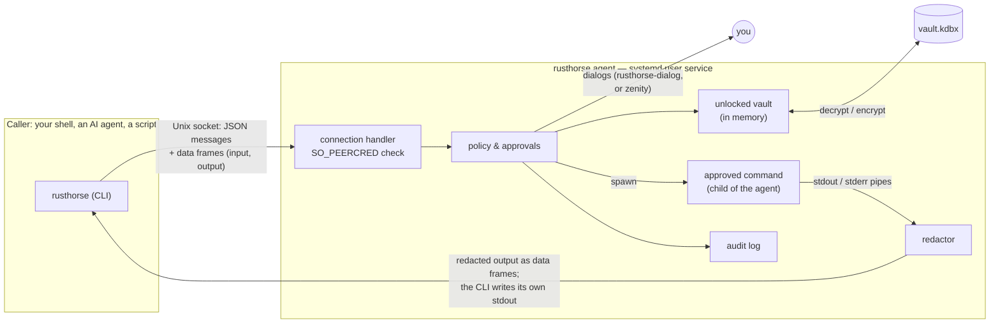
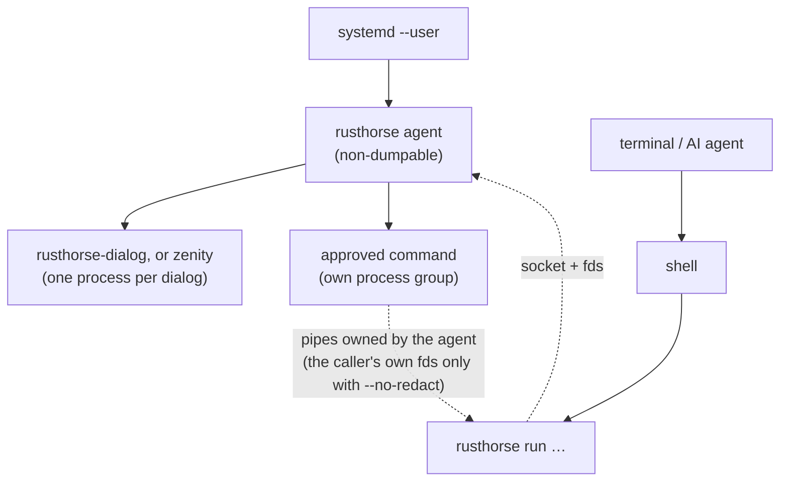

# Architecture

This document explains how Rusthorse is put together: the components, how a
request flows through them, how data is stored, and where each part lives in
the code. Security reasoning is in the [threat model](threat-model.md); the
wire format is in [protocol.md](protocol.md).

## Overview



The CLI and agent share a binary; the dialog and manager are optional
separate programs:

- **The agent** (`rusthorse agent`) runs for the whole desktop session. It is
  the only component that decrypts the vault, holds the decrypted database, shows approval/secret-entry
  dialogs and starts approved commands. An approved `reveal` also sends one
  value to its client.
- **The CLI** (every other subcommand) is a thin client. It turns command-line
  arguments into one request, sends it over the socket, prints the response
  and exits. It never handles the master password, and for `run` it never
  handles secret values.
- **`rusthorse-manager`** (GTK 4 and libadwaita, built separately) is a
  window to manage entries: a client of the agent like the CLI, which shows
  or copies a value only through an approved `reveal`. It never opens the
  vault or asks for a master password. See [Visual manager](#visual-manager).
- **`rusthorse-dialog`** (GTK 4 and libadwaita, built separately) shows one
  dialog for the agent and exits. Without it, the agent uses zenity.

## Process model



- The agent is started by systemd, so it is **not** a descendant of the
  caller. Linux (with Yama `ptrace_scope=1`, the default on Ubuntu and Mint)
  only lets a process inspect its own descendants, and the agent also marks
  itself non-dumpable (`PR_SET_DUMPABLE=0`), which blocks inspection by any
  other process of the same user and disables core dumps.
- Approved commands are children of the agent, in their own process group.
  The caller's shell cannot attach to them with a debugger either.
- Dialogs are separate processes started by the agent — `rusthorse-dialog`,
  or zenity when it is not installed. The caller cannot answer them through
  its terminal.

## Lifecycle of a `run` request

```mermaid
sequenceDiagram
    autonumber
    participant C as rusthorse run (caller)
    participant A as agent
    participant Z as dialog
    participant X as approved command

    C->>A: connect; Run{bindings, argv, cwd, env, redact} (fds 0,1,2 only with --no-redact)
    A->>A: SO_PEERCRED: same uid? read process chain
    alt vault locked
        A->>Z: master password dialog
        Z-->>A: password
        A->>A: decrypt vault.kdbx (Argon2id)
    end
    A->>A: check entries exist (UUIDs), resolve program, clean environment,<br/>refuse details too long to show
    alt remembering enabled and an identical request was approved
        A->>A: use remembered approval
    else
        A->>Z: approval dialog (command, program, directory, secrets, requester, warnings)
        Z-->>A: Allow once / Deny (/ Allow for N, if enabled) — via a socket pair
    end
    A->>A: audit record (fail closed)
    A->>A: re-check: same vault generation? same program and directory inodes? same entries?
    A->>X: spawn with env + secrets; stdout, stderr = agent-owned pipes;<br/>stdin = /dev/null (or a pipe with --stdin)
    loop while running
        opt run --stdin
            C-->>A: the CLI reads its own stdin and sends it as data frames
        end
        X-->>A: output
        A-->>C: redacted output as data frames; the CLI writes it to its stdout/stderr
    end
    X-->>A: exit (not yet reaped)
    A->>A: terminate what is left of its process group, join all workers, reap
    A->>A: audit record (exit status)
    A-->>C: Exited{code, signal}
    C->>C: exit with the same status
```

When the command exits, and also if the caller disconnects (for example it is
killed or interrupted) before that, the agent sends `SIGTERM` to whatever is
left of the command's process group and `SIGKILL` three seconds later.

The leader is reaped only afterwards, so its process group id cannot be
reused by an unrelated process while it is being signalled. A process whose
main thread has exited while other threads still run counts as alive.

With redaction, the agent never touches the caller's own descriptors. It
sends the redacted output over the connection as data frames, and the
`rusthorse run` process writes them to its stdout and stderr (and, with
`--stdin`, reads its own stdin and sends it on). Output is delivered like in a
pipeline: while the caller stays connected, the agent waits for it to read,
however slowly. `rusthorse run` writes each channel on its own thread and
grants the agent credit per channel as it writes, so a stuck stdout does not
hold up stderr (each channel has a 1 MiB window). The only thing the agent
writes is its own socket. A full close, a half-close or a protocol violation
by the caller cancels the request: the agent shuts the socket down — which
fails any send in progress at once — and terminates the command. Input has
its own window too, so input that the command has not read yet never stops
the agent from reading the connection. If the caller's stdout is closed
(`| head`), `rusthorse run` shuts the connection down (through a handle that
needs no lock) and exits with status 141, like a process killed by
`SIGPIPE` — within about half a second, even if its other output is stuck.

## Policy

| Request | Unlock needed | Human interaction | Remembered |
|---|---|---|---|
| `status`, `lock` | no | none | — |
| `unlock` | — | master password dialog | — |
| `list`, `show` | yes | none — metadata only | — |
| `add` (value typed by you) | yes | value dialog | — |
| `add --stdin` | yes | approval | no |
| `add --generate` | yes | approval (the agent generates the value) | no |
| `change_password` | yes | current and new password dialogs | no |
| `import` | yes | one approval for the batch | no |
| `edit` | yes | approval (+ value dialog with `--value`) | no |
| `remove` | yes | approval | no |
| `reveal` | yes | approval with a warning; the dialog names the client's stated purpose (print, show, copy) | no |
| `run` | yes | approval | opt-in (`--remember`), exact match |

"Metadata" is the entry name, group, username, URL, host, port, tags, whether
a value and notes exist, the *names* of other fields and the modification
time. Values, notes and the values of other fields are never sent without
approval.

Fields that the KDBX file marks as *protected* (KeePassXC lets you protect
any field) are withheld from metadata as well; `protected_fields` lists their
names.

### Vault generation

The agent keeps a *generation* counter, incremented on every unlock, lock and
saved change. Every approval-gated request records the generation before it
asks the human and acts only if it is unchanged afterwards — checked under the
same lock that reads the values or applies the change — so a lock, edit or
removal that happens while a dialog is open cancels the request instead of
acting on stale information. An unlock records the generation before showing
the password dialog and is cancelled if a `lock` arrived meanwhile.

### Remembered approvals

Off by default ([ADR 0005](adr/0005-remembered-approvals-opt-in.md)). With
`--remember DURATION`, "Allow for DURATION" stores, in memory only, a key made
of the vault generation, the bindings and entry UUIDs, the exact command line,
canonical program path, working directory, redaction and stdin-forwarding
flags and the complete effective environment (sorted by name, as the command
receives it). A later request is approved without a
dialog only if its key is identical and the time has not expired; any change
to the vault therefore invalidates it. Requests whose details are too long to
display in full are refused outright.

### Locking

The decrypted vault is dropped after `--idle-timeout` (default 15 minutes)
without an *approved* use (`status`, `list`, `show` and denied requests do
not count), on `rusthorse lock`, when a save fails, and when the agent stops.
A command that is already running keeps the secrets it was given.

## Storage format

The vault is a standard KeePass **KDBX 4** file, written with the
[`keepass`](https://crates.io/crates/keepass) crate:

- Outer encryption AES-256, inner stream ChaCha20, GZip compression.
- Key derivation for new vaults: Argon2id, 64 MiB, 20 passes, 2 lanes
  (about 0.7 s per unlock on a desktop CPU). Existing files keep their own
  parameters.

### Field mapping

| Rusthorse | KDBX field | Protected in the file | Returned without approval |
|---|---|---|---|
| name | `Title` | no | yes |
| username | `UserName` | no | yes |
| value | `Password` | yes | **no** |
| url | `URL` | no | yes |
| host | `Host` (custom) | no | yes |
| port | `Port` (custom) | no | yes |
| notes | `Notes` | yes | **no** |
| tags | `Tags` | — | yes |
| group | entry's group path | — | yes |
| other fields | custom fields | as stored | names only |

Entries in the recycle bin are ignored. Edits record the previous state in
the entry's KeePass history, so KeePassXC can show and restore old versions.

### Saving

Every change is saved immediately:

1. The new database is written to a temporary file in the same directory
   (mode `0600`) and `fsync`ed.
2. The current file is hard-linked to `vault.kdbx.bak`.
3. The temporary file is renamed over `vault.kdbx` (atomic) and the directory
   is `fsync`ed.

Before step 1, and again just before step 3, the agent compares the file's
device, inode, size and modification time with what it loaded. If another
program (KeePassXC, a sync client) changed the file, the save is refused with
`vault_changed` instead of silently discarding those changes; locking and
unlocking reloads the file. The two checks narrow the window but are not an
atomic compare-and-swap, so only one program should write the vault at a time
(threat model L15). Every change is a transaction on an in-memory copy: if any
part of it fails (one invalid entry in an import, say), all of it is rolled
back. If the save itself fails, the agent locks the vault so that memory never
holds changes that are not on disk. A failure after step 3's rename — syncing
the directory — is different: the new file is already in place, so the agent
answers `outcome_unknown` (the change may not survive a crash) rather than
"not saved", and locks the vault so that the next unlock reads whatever the
file then holds. After a password change, the old-password `vault.kdbx.bak`
is deleted only once a save has completed.

Deleted entries are recorded in the KDBX `DeletedObjects` list, so that
merging with an older copy does not bring them back. Vault files larger than
128 MiB are refused before anything is decrypted.

## Concurrency

The agent accepts connections on one thread and handles each connection on
its own thread; a connection carries exactly one request, which must arrive
within 10 seconds. At most 64 connections are handled at once and at most 8
requests may wait for a dialog; more are refused. Shared state (the vault,
the generation, the last-use time and remembered approvals) sits behind one
mutex that is never held while a dialog is open or a command is running. A
second mutex serializes dialogs, so you are asked one question at a time. A
background thread checks the idle timeout every second.

### Dialogs

The agent shows its dialogs with `rusthorse-dialog`, Rusthorse's own GTK 4
program ([ADR 0006](adr/0006-own-dialog-program.md)), and with zenity only
when that program is not installed. Both are separate processes started from
an absolute path, with `/` as working directory and a minimal environment,
and both answer through a socket pair rather than a pipe, because other
processes of the same user can open a pipe through `/proc/<pid>/fd` but not
a socket. Default **Deny**, a timeout that denies, and only exact, expected
answers approve, in both.

Every string a dialog shows goes through `ui::dialog_text` first. Dialogs
draw only characters whose glyphs are predictable: printable ASCII, the
letters of Latin-1 and Latin Extended-A (accented letters of European
languages) except look-alikes of ASCII (`×`, `÷`, `ı`, `IJ`, `ij`, `ĸ`, `ʼn`,
`ſ`), and the punctuation of Rusthorse's own texts. Every other character —
controls, line and paragraph separators, invisible and combining characters,
other scripts, emoji — is shown as a `\u{…}` escape, so nothing a requester
sends can hide, reorder or overlap other text, letters of other scripts cannot
pass for Latin ones, and what is drawn has a known width. (Text that literally
contains `\u{…}` looks the same as an escape; the reader must assume the
character it names.)

**`rusthorse-dialog`.** The agent looks for it in the directory of its own
executable only, and uses it if — after resolving links — it is a regular,
executable file owned by the user or root that neither its group nor others
can write (under the umask of Debian, Ubuntu and their derivatives,
`cargo install` leaves it group-writable: the installation guide removes that
bit). If
the agent's own executable was replaced since it started, it shows no dialog
until restarted. The program gets one end of a socket pair as standard input
and output: the agent sends one length-framed JSON request (at most 64 KiB:
version, a random identifier, the dialog's texts) and closes its sending
side; the program answers with one frame (at most 8 KiB) carrying the same
version and identifier, and exits. An approval needs that one well-formed
answer, end of stream and a clean exit, all within one deadline (the dialog
timeout plus 5 seconds), recalculated before every read and write, so that an
answer sent a byte at a time cannot stretch it; after it the dialog counts as
unanswered. The program runs in its own process group, which the agent kills
— descendants that kept the socket open included — and then the program
itself, in case it left the group, before it reaps it, so neither id can
have been reused. Anything else — a crash, a partial, oversized or
contradictory answer, a failure after answering — is an error, never an
approval. Its environment holds only the session's display, D-Bus and locale
variables (and the X authority file, resolved before `HOME` changes), with
`HOME` and the XDG directories pointing to a new `0700` directory removed
after the dialog, and in-memory GSettings: no per-user GTK configuration,
style sheet or setting can restyle the dialog or enable the GTK Inspector.
The program refuses a request of another version, or with text that is not
drawable as it is, before showing anything. It shows every string as plain
text — no markup — in a window whose content scrolls while the buttons stay
in view; when the content does not fit, **Allow** stays disabled until its end
has been in view once (an obligation to reach the end, not proof of reading),
and a line next to it says "Scroll to the end to allow".
Selectable text takes the keyboard focus, so the end can be reached without a
mouse.

**zenity.** zenity is run from `/usr/bin` (or `/usr/local/bin`), never
through `PATH`, under the same supervision: its own process group, a deadline
(its timeout plus 5 seconds), at most 64 KiB of output. Text for the entry dialog has backslashes and underscores
escaped. The question dialog is laid out with Pango markup — a headline, an
explanation, one block per detail, the facts in one quieter line, the
warnings in bold — after `&`, `<`, `>`, quotes and the backslash become
character references (the backslash as `&#92;`, which reads the same whether
or not zenity processes escape sequences), so a value can neither add a tag
nor be changed. It uses no colour or icon of its own, only options zenity 3
and 4 share. Only an exit status of 0 with no output (Allow once), or 1 with
the exact label of the extra button (Allow for N), counts as approval.

zenity's dialogs cannot scroll, and their buttons sit below the content, so
with zenity a request whose dialog would be too tall to read at once is
refused rather than shown truncated. The height is estimated in pixels for an
11-point interface font at 96 DPI: details are monospaced (every character
the same width; one outside ASCII counted twice), warnings, which may quote
the requester, are measured as if every character were a bold "W", and lines
are wrapped word by word as Pango does, so text built from words just over
half a line long is counted as the line per word it really takes. The content
may take at most 880 pixels, leaving 200 for the title bar, buttons and a
desktop panel on a 1080-pixel screen. In the dialogs measured with the real
renderer (Sans 11, nearly two thousand built to be as tall as possible), the
real height stayed below the estimate, by 1 to 60 per cent. Larger fonts, a
higher scale or a smaller screen make dialogs taller than estimated.

With either program, a request whose dialog text would exceed 4000
characters (counting the room reserved for the "Allow for" note) is refused,
and `import` splits large imports into batches whose names take at most 24
lines.

## Audit log

Each decision appends one JSON object to `audit.jsonl`: time, action, outcome,
entry names, requester chain and, for `run`, the command line and directory.
The time is taken from the system clock when the record is written, so an
approval is dated after the human answered (usually within a moment), not
when the request arrived. Values are never logged. If a record cannot be written, approval-gated
requests are refused ("fail closed"). See [cli.md](cli.md#rusthorse-audit).

## Code map

| Module | Responsibility |
|---|---|
| [`src/main.rs`](../src/main.rs) | Command-line parsing and output formatting. |
| [`src/agent.rs`](../src/agent.rs) | The agent: socket server, policy, unlock, approvals, `run`. |
| [`src/vault.rs`](../src/vault.rs) | KDBX4 access, field mapping, atomic saves. |
| [`src/protocol.rs`](../src/protocol.rs) | Request and response types, framing, fd passing. |
| [`src/client.rs`](../src/client.rs) | Client side of the protocol; relays a `run`'s input and output. |
| [`src/ui.rs`](../src/ui.rs) | The `Ui` trait, `dialog_text`, and the zenity implementation. |
| [`src/dialog_program.rs`](../src/dialog_program.rs) | Finding, starting and supervising `rusthorse-dialog`; falling back to zenity. |
| [`src/dialog_protocol.rs`](../src/dialog_protocol.rs) | The protocol between the agent and `rusthorse-dialog`. |
| [`dialog/`](../dialog) | `rusthorse-dialog`, the GTK 4 dialog program, and its tests on a virtual display. |
| [`manager/`](../manager) | `rusthorse-manager`, the GTK 4 window to manage entries: agent requests on a worker, the single-paste clipboard content, tests on a virtual display. |
| [`src/exec.rs`](../src/exec.rs) | Program resolution and environment cleaning for `run`. |
| [`src/redact.rs`](../src/redact.rs) | Streaming redaction of secret values. |
| [`src/peer.rs`](../src/peer.rs) | Peer credentials and the requester process chain. |
| [`src/audit.rs`](../src/audit.rs) | The audit log. |
| [`src/import.rs`](../src/import.rs) | `.env` and Secret Service importers. |
| [`src/paths.rs`](../src/paths.rs), [`src/util.rs`](../src/util.rs) | Locations and helpers. |
| [`tests/agent.rs`](../tests/agent.rs) | End-to-end tests against a real agent. |

## Design decisions

The reasoning behind the main choices is recorded as
[architecture decision records](adr/README.md):

- [ADR 0001](adr/0001-kdbx4-storage.md) — KeePass KDBX4 as the storage format
- [ADR 0002](adr/0002-agent-mediated-execution.md) — the agent, not the client, runs approved commands
- [ADR 0003](adr/0003-agent-side-dialogs.md) — approvals are dialogs shown by the agent
- [ADR 0004](adr/0004-native-distribution.md) — native binary and systemd, no Flatpak
- [ADR 0005](adr/0005-remembered-approvals-opt-in.md) — remembered approvals are opt-in

## Visual manager

`rusthorse-manager` ([ADR 0007](adr/0007-visual-manager.md),
[user guide](manager.md)) is a separate GTK 4 client of the agent, like the
CLI: it never opens the vault and never receives the master password. Its
forms carry metadata only; every change is a request the agent approves in
its own dialog.

- **Requests.** It uses the protocol-3 requests and targets entries by UUID.
  Before each request it checks the agent's protocol version. One request
  started by the human runs at a time, on a worker thread, with bounded
  waits; closing the window shuts the connection down. A lost answer to a
  request with effects is reported as an unknown outcome, never retried.
- **Status.** A background `status` every five seconds, also while a
  request waits for the human; it never blocks the controls and does not
  postpone the idle lock. A result that predates a request of the human's is
  ignored. A lock it observes clears the entries, a shown value and a copied
  value, and a value returned afterwards by the waiting request is dropped;
  an unlock done elsewhere (the CLI) loads the list, which asks nothing
  because the vault is open.
- **Show.** `reveal` with purpose `show`: the value appears in a window of its
  own, not selectable, grouped by four characters when that cannot mislead,
  for at most 30 seconds or until the window loses focus.
- **Copy.** `reveal` with purpose `copy`: the value goes to the clipboard
  through a content provider that delivers it **once** — every later request
  fails — and wipes it after 20 seconds, on lock, on close and at shutdown
  (signals included). Wiping empties the provider and never claims the
  clipboard again, which could destroy what another program has just
  copied. See [ADR 0007, section 2](adr/0007-visual-manager.md#2-show-copy-and-memory)
  and [threat model L14](threat-model.md#l14--some-flows-move-values-through-the-client).
- **Memory.** Values live in zeroizing buffers in Rust; GTK's own copies
  (labels, clipboard transfers) are emptied when no longer needed but cannot
  be wiped reliably. The process is non-dumpable.
