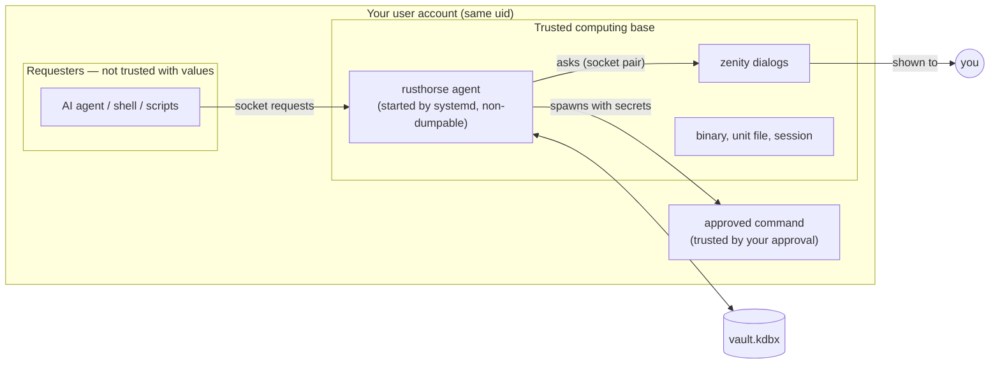

# Threat model

This document states what Rusthorse protects, against whom, how, and — just
as important — what it does not protect. If you find a gap between this
document and the code, that is a bug; please report it
([SECURITY.md](../SECURITY.md)).

- Applies to: Rusthorse 0.1.x
- Last reviewed: 2026-10-31 (see [review history](#11-review-history))

## 1. Scope and the exact guarantee

Rusthorse is a local, single-user secrets vault for Linux desktops. A
long-running agent holds the decrypted KeePass database; clients (the CLI,
scripts, AI coding agents) ask it to *use* secrets. Two different guarantees
are easy to confuse, so they are stated separately:

1. **Preventing accidental exposure — provided.** A requester that is
   cooperative but fallible (an AI agent that makes mistakes, over-shares or
   follows instructions planted in what it reads) can use a secret for a
   purpose you approved without the value entering its memory, output, logs
   or context, and without being able to use it for something you did not
   see.
2. **Resisting a hostile requester that runs code as your user — not
   provided on a normal desktop.** A requester that deliberately attacks
   Rusthorse from a shell running as your user, in your graphical session,
   can defeat it: on X11 it can click "Allow" or log the master password as
   you type it ([L2](#l2--x11-lets-any-program-act-on-your-dialogs)), and it
   can read the environment of approved commands while they run
   ([L3](#l3--the-environment-of-a-running-approved-command-is-readable)).
   Rusthorse raises the cost and leaves a trail, but it is not a sandbox.

To get the second guarantee, the AI agent must run **isolated** from your
session: as a different Unix user (or in a container/VM) without access to
your X11/Wayland display, your session D-Bus, your processes in `/proc`, your
home directory and the agent's files — with only the Rusthorse socket made
available to it. [Section 8](#8-running-ai-agents-in-isolation) describes
this setup. It is outside what Rusthorse can enforce on its own.

## 2. Assets

| Asset | Why it matters |
|---|---|
| Secret values (`Password` field) | The thing being protected. |
| Notes and other protected fields | Often contain recovery codes or secondary secrets. |
| The master password | Unlocks everything, including copies of the vault elsewhere. |
| Approval decisions | The human's control over *what* a secret is used for. |
| Metadata (names, usernames, URLs, hosts, ports, tags) | Reveals what you have access to; useful for targeting. Treated as low sensitivity unless the file marks a field protected. |
| The vault file and its backups | Encrypted at rest; exposed to offline guessing if copied. |
| The audit log | Lets you notice misuse after the fact. |

## 3. Adversaries

| # | Adversary | Capabilities | Design target? |
|---|---|---|---|
| A1 | **Fallible AI agent** — cooperative, but makes mistakes, or follows instructions planted in content it reads (prompt injection) | Runs commands as you through its shell tool; reads and edits files; sees command output | **Primary** |
| A2 | **Hostile requester as the same user** — a fully hijacked agent or a malicious script deliberately trying to obtain secrets | Everything A1 can do, deliberately: writes its own socket client, races files, uses `/proc`, synthesizes X11 input | Only when isolated (§8); otherwise raise cost and leave a trail |
| A3 | **Malware running as you** with persistence | Modifies your files, binaries, shell startup, systemd units | No — see L1 |
| A4 | **Other local users** | Their own uid; no root | Yes |
| A5 | **Someone with a copy of the vault file** (backup, sync service, stolen disk) | Offline computation | Yes |
| A6 | **Root, the kernel, hardware, physical access to an unlocked session** | Everything | No |

## 4. Trusted computing base

Rusthorse's guarantees hold only if all of the following are trustworthy:

- the `rusthorse` binary, the systemd unit and the session that starts it;
- the libraries it links (notably the `keepass` crate, which implements the
  file format and its cryptography) and the Rust toolchain that built it;
- `zenity` and the GTK stack it uses, the X server or Wayland compositor that
  displays dialogs and delivers your keystrokes;
- the kernel (Yama `ptrace_scope ≥ 1`, which is the default on Ubuntu, Mint,
  Debian and Fedora) and the file system holding the vault;
- **every program you approve**, for the secrets you approve it for, and
  everything that program loads or executes (L4).

## 5. Trust boundaries

The boundary that matters is between **requesters** and the **agent**.

## 6. Security properties and mechanisms

| # | Property | Mechanism | Holds against |
|---|---|---|---|
| P1 | A requester never receives a secret value, notes or a protected field without an approval for that specific request. | Only `reveal` returns a value, after a non-rememberable approval. `list`/`show` return metadata only, and withhold any field the KDBX file marks as protected — including a protected title, which is shown as `[protected title]` and matched only by UUID — reporting only the field's name. | A1, A2 |
| P2 | The approved command line, program, directory and environment are the ones used. | The agent resolves the program to a canonical path, fixes arguments, directory and environment, shows them, checks the program's and directory's identity (device and inode) again after you answer, and spawns the command itself ([ADR 0002](adr/0002-agent-mediated-execution.md)). A custom client cannot substitute another command. A swap in the instant between that check and the start of the program, and changes to file *contents*, are not prevented (L4). | A1, A2 |
| P3 | An approval is acted on only if the vault did not change while you decided. | A vault *generation* counter is bumped on unlock, lock and every saved change. The generation is checked under the same lock that reads the values, so an edit, lock or reload while the dialog was open cancels the request. Reading the values *consumes* the approval: a `lock` after that point does not stop the command. A `lock` while the master password is being typed cancels the unlock. | A1, A2 |
| P4 | Secrets used by `run` are not placed in a process the requester can inspect with a debugger. | The command is a child of the agent, not of the requester; Yama blocks `ptrace` from outside its ancestry. See L3 for `/proc/<pid>/environ`. | A1, A2 (partially) |
| P5 | Secret values printed by an approved command do not reach the requester verbatim. | With redaction (the default), the command's stdout and stderr are pipes owned by the agent; the filtered output travels to the requester as data frames over the socket, and the requester writes it itself. The command's stdin is `/dev/null`, or an agent-owned pipe fed from the requester's data frames with `run --stdin`. The requester's own descriptors never reach the command or the agent, so there is no unfiltered way back. Exact-match only (L5). | A1 |
| P6 | The master password and new secret values never pass through a requester. | The agent asks for them in its own dialogs; the protocol has no field for the master password. zenity's answer comes back over a socket pair, which other processes cannot open through `/proc/<pid>/fd` (a pipe could be). The one exception is `rusthorse init`, which reads the password of a *new* vault in the CLI (terminal or dialog) before any agent is involved. | A1, A2 (not on X11, L2) |
| P7 | Dialogs are not answered by the requester and say what they mean. | Separate processes on the desktop, not in the terminal; zenity runs from an absolute path with a minimal environment and `/` as working directory; requester-controlled text is escaped (control, bidirectional and zero-width characters; backslashes and underscores for zenity's entry dialog); entries are identified by full path and UUID, so two entries with the same title never look alike; requests whose dialog text would exceed 4000 characters (or 1000 for one field) are refused, never truncated; default button **Deny**; unanswered dialogs are denied; only exact, expected zenity results count as approval. | A1, A2 (not on X11, L2) |
| P8 | Only your user can talk to the agent. | Socket in a `0700` directory, mode `0600`, `SO_PEERCRED` uid check. | A4 |
| P9 | The decrypted vault is not held longer than needed. | Auto-lock after 15 minutes without an *approved* use — `status`, `list`, `show` and denied requests do not postpone it; `rusthorse lock`; lock on any save failure. | A1, A2, A6 (window) |
| P10 | The agent's memory is not readable by other same-user processes and is not dumped. | `PR_SET_DUMPABLE=0` and `RLIMIT_CORE=0` on the agent. Dialogs and approved commands inherit `RLIMIT_CORE=0`, but `execve` makes them dumpable again, and with a piped `core_pattern` (systemd-coredump) whether a crash is stored is up to that handler. | A1, A2 |
| P11 | The vault is confidential at rest. | KDBX4: AES-256, Argon2id (64 MiB, 20 passes for new vaults); files `0600`, directories `0700`. | A4, A5 |
| P12 | Every decision leaves a record. | JSON Lines audit log, `fsync`ed per record. Unlocking and approval-gated actions fail closed: if the record cannot be written, the vault stays locked or the action does not happen. | A1 (detection; L13) |
| P13 | The agent stays available under request floods. | The whole request must arrive within 10 s of connecting (a deadline, not a per-read timeout); at most 64 connections and 8 requests waiting for a dialog at once; frames ≤ 4 MiB; imports ≤ 100 entries; vault files ≤ 128 MiB. | A1, A2 (availability) |
| P14 | Approved changes are all-or-nothing and match the disk. | Every change runs as a transaction that is rolled back if any part fails (for example one invalid entry in an import); if saving fails, the vault is locked so memory never holds unsaved changes. | Accidents |

### Who starts the agent

A process can read the memory of the processes it starts (with the default
Yama setting), preload code into them (`LD_PRELOAD`) and change their
environment. If an AI agent's shell started `rusthorse agent`, it could do all
of that before the agent protected itself. The agent must therefore be started
by systemd, outside every requester's process tree. `rusthorse agent` prints a
warning when its parent is not systemd. The agent marks itself non-dumpable at
startup, which blocks inspection by any other unprivileged process from then
on.

### What an approval means

| Answer | What it authorizes |
|---|---|
| **Allow once** | This one request, exactly as shown. |
| **Allow for N** (opt-in, `--remember`, off by default) | A reusable capability: for N minutes, any request with the same entries (by UUID), the same vault generation, command line, program, directory, redaction setting and environment runs **without asking**. It does not cover what the command reads — its standard input, files, network responses — which can differ on each run (L8). |
| **Deny**, closing the dialog, timeout | Nothing. The command does not run. |

Locking, unlocking and any saved change invalidate remembered approvals.

## 7. Known limitations and residual risks

### L1 — Malware running as you can defeat Rusthorse

It can replace the `rusthorse` binary, the systemd unit or your shell startup
files, wait for you to unlock, and capture the master password or the
decrypted data. No program running with your privileges can prevent this.
*Mitigation:* keep the account clean; run AI agents isolated (§8).

### L2 — X11 lets any program act on your dialogs

On X11, every client can synthesize keyboard and mouse input (XTEST,
`xdotool`) and read other windows and keystrokes. A hostile requester in your
session can press "Allow once" on the approval dialog, or log the master
password as you type it. A dialog answer is therefore **not proof that a human
decided** against such a requester. *Mitigation:* prefer a Wayland session,
where clients are isolated; isolate the AI from your display entirely (§8).
The default button is **Deny** and dialogs time out, which only helps against
accidents. This is the most important limitation on X11 desktops such as
Cinnamon and MATE.

### L3 — The environment of a running approved command is readable

While an approved command runs, any process of the same user can read
`/proc/<pid>/environ`, which contains the secret. Marking the process
non-dumpable would prevent that, but `execve` resets the flag. *Mitigation:*
short-lived commands; the planned SSH agent and HTTP broker keep secrets out
of the environment altogether.

### L4 — Approving a command trusts everything it executes

If you approve `python deploy.py`, the secret goes to whatever `deploy.py`
contains when it runs — and an AI agent can edit that file, even between your
answer and the start of the command. Rusthorse checks the identity (device and
inode) of the program and of the working directory again after you answer,
which catches a file swapped for another while the dialog was open. It does
not pin them — a swap in the instant between that check and the start is
still possible — and it does not notice a file rewritten in place, nor the scripts,
modules, configuration files (`~/.gitconfig`, `.curlrc`, `.npmrc`) and
plugins the program loads. The same applies to `sh -c '…'` and interpreters
with inline code. The agent removes `LD_*` variables and warns about a list
of variables that change what programs execute (`NODE_OPTIONS`,
`PYTHONPATH`, `GIT_SSH_COMMAND`, …), but such a list cannot be complete.
*Mitigation:* read the dialog; prefer well-known binaries with explicit
arguments; review recent changes to scripts before approving them.

### L5 — Redaction only catches exact copies in the command's output

A command that prints the secret encoded (base64, hex, URL-encoded), split,
reversed or partially is not redacted, and secrets shorter than 4 characters
never are. A command can also send the secret over the network, write it to a
file, or put it in its own logs — none of which pass through the redactor.
Redaction prevents *accidental* disclosure on stdout/stderr; it is not a
defense against exfiltration by a command written to leak.

### L6 — Metadata is visible without approval

While the vault is unlocked, any process of your user can list entry names,
usernames, URLs, hosts, ports and tags (fields marked protected in the KDBX
file are withheld). This is deliberate — an agent needs to know what exists
and where it points — but do not put secrets in those fields.

### L7 — Memory hygiene is best effort

Rusthorse wipes the buffers it controls (`Zeroizing`), but copies made by JSON
parsing, the KeePass library, zenity/GTK and the standard library's process
spawning are not all wiped. Memory is not locked, so secrets can reach swap or
a hibernation image. *Mitigation:* full-disk encryption (which covers swap).

### L8 — Remembered approvals are a capability, not a decision per use

When enabled, "Allow for N" approves identical requests without asking, even
when they read different input. For example, `curl --config -` with a
remembered approval sends the token wherever the next request's standard input
says. This is why remembering is **off by default** and should only be enabled
for commands whose inputs you control. See [ADR 0005](adr/0005-remembered-approvals-opt-in.md).

### L9 — Dialog information can mislead

Process names in the requester chain are chosen by the processes themselves,
pids can be reused, and a socket can be handed to another process, so the
chain is informative only. A flood of requests can cause approval fatigue.
*Mitigation:* treat unexpected dialogs as a warning sign; deny when in doubt.

### L10 — The vault can be attacked offline

Anyone with a copy of the file or one of its backups can try passwords at a
cost set by Argon2id. A weak master password will fall. Old values remain in
entry history, in `vault.kdbx.bak` and in any copies you made. *Mitigation:* a
long, unique passphrase (`rusthorse passwd` changes it and deletes the
`.bak` file encrypted with the old one — but not copies made elsewhere);
rotate credentials at the provider when they may have leaked — deleting an
entry does not revoke anything (`rusthorse edit NAME --generate` makes the
new value).

### L11 — Command lines are not secret

Arguments are shown in dialogs, stored in the audit log and visible to other
processes. Never put a secret on a command line; pass it through `run`.

### L12 — Denial of service

Any process of your user can lock the vault, keep dialogs coming (one at a
time, at most eight waiting), or stop the agent. Opening a crafted vault file
with extreme KDF parameters can make unlocking very slow (files over 128 MiB
are refused, but KDF parameters are not yet bounded). These are annoyances,
not disclosures.

### L13 — The audit log is not tamper-proof

Any process of your user can edit or delete it. It helps you notice misuse by
a cooperative-but-wrong agent; it is not evidence against a hostile one. It
records command lines, which may contain sensitive data if you put it there.

### L14 — Some flows move values through the client

`reveal` returns the value to the requesting process (its purpose; never
remembered); `import` reads values in the client before sending them to the
agent; `add --stdin` sends a value the client already has. None of these
should be run by an AI agent. Importing also does not remove the original
copies (for example in GNOME Keyring).

### L15 — Concurrent edits by other programs

The agent refuses to save if the vault file changed since it was loaded and
checks again right before replacing it, but the check and the rename are not
atomic: KeePassXC or a sync client saving at that exact moment can lose its
change. Only one program should write the vault at a time — lock the agent
(`rusthorse lock`) before editing in KeePassXC.

### L16 — Approved commands run outside the requester's sandbox

The command is started by the agent, as you, with the agent's privileges —
not inside whatever sandbox (container, seccomp policy, network restrictions)
the requester runs in. Approving a command from a sandboxed AI agent grants
that command your full access. The dialog states this.

### L17 — Descendants that leave the process group outlive the command

When the command exits — or the requester disconnects first — every remaining
process in its process group is terminated (SIGTERM, then SIGKILL after 3
seconds), so background jobs started by the command do not keep the secret.
A process counts as alive while any of its threads is (its main thread may
already have exited).
A descendant that started a new session or group (`setsid`, `setpgid`)
escapes this and keeps the secret in its environment; stopping the agent's
systemd service kills all of them (cgroup). *Planned:* one cgroup per command.

### L19 — A connected client that does not read holds the request open

Output is delivered like in a pipeline: while the requester stays connected,
the agent waits for it to read, however long that takes, and keeps the copy
of the secret values that the redactor needs. Meanwhile the command may
itself be blocked writing its output, exactly as it would be in a pipeline
whose reader stopped. Stdout and stderr have separate 1 MiB flow-control
windows, so one stuck channel does not stop the other. The request ends as
soon as the requester reads its output, or closes, half-closes or breaks the
connection (each of which cancels it: the agent shuts the socket down, which
fails a pending send at once). A requester that does neither ties up one of
the agent's 64 connections.

### L18 — Forwarded input races the end of the command

With `run --stdin`, the `rusthorse run` process reads its own stdin and sends
it to the agent while the command runs. Input typed in the instant the command
finishes may be read by `rusthorse run` — which exits right after — and lost
instead of reaching the next program that reads the terminal. Programs using
the library API (`Client::run_with`) get the same behaviour: the input reader
reads only after `poll` reports data and normally stops within about 100 ms
after the call returns. If another process reads the same input at the same
moment — between that `poll` and the `read` — the reader stays blocked in
`read` and may later consume input meant for someone else; interrupting it
would require changing file flags shared with the caller. Without `--stdin`
(the default), the requester's input is never read. With `--stdin`,
nothing is read before the command has started: a denied request leaves the
input untouched.

## 8. Running AI agents in isolation

To make Rusthorse resist a hostile requester (A2), deny the AI everything that
L2, L3 and L16 rely on. A practical setup:

- Run the AI agent as a separate Unix user (or in a container or VM).
- Do not give it your display: no `DISPLAY`/`WAYLAND_DISPLAY`, no access to
  your X authority file or Wayland socket, no session D-Bus.
- With `hidepid=2` on `/proc` (or a separate PID namespace) it cannot see your
  processes; as another user it cannot read their environment anyway.
- Expose only the Rusthorse socket to it (for example with a group-owned
  socket path), and accept that approved commands then run as *you* — keep
  them narrow.

Rusthorse 0.1 checks that the peer has the **same** uid, so this setup needs
a small extension (an allow-list of uids) that is on the roadmap.

## 9. Recommendations

- Start the agent only through the systemd unit.
- Prefer a Wayland session; use full-disk encryption.
- Give AI agents narrowly scoped, revocable credentials (per-repository
  tokens, API keys with spending limits), stored as separate entries.
- Keep `--idle-timeout` short; lock when you step away; leave `--remember`
  off unless you need it.
- Read every dialog; be suspicious of `sh -c`, scripts the agent just edited,
  unexpected programs or directories, and risky-variable warnings.
- Edit the vault in other programs only while the agent is locked.
- Look at `rusthorse audit` from time to time.

## 10. Planned improvements

- **SSH agent and local HTTP broker**: secrets used *by the agent* for a
  typed operation (destination, method) instead of being placed in a
  command's environment — addresses L3, L5 and most of L4 for those cases.
- **Isolation support** (§8): uid allow-list on the socket and documentation
  for running agents as a separate user.
- **One cgroup per approved command** (L17), with resource limits.
- **Bounded KDF parameters** before unlocking (L12).
- **Per-entry policies**: restrict an entry to listed programs or hosts.
- **An in-process GUI** (instead of zenity) with scrollable details and a
  grants panel to inspect and revoke remembered approvals.
- Signed release artifacts.

## 11. Review history

| Date | Review | Outcome |
|---|---|---|
| 2026-10-31 | Initial threat model, written with the first implementation. | — |
| 2026-10-31 | Adversarial design and code review (AI-assisted, Codex). | See below. |
| 2026-10-31 | Second review of the code and of the fixes (AI-assisted, Codex). | See the second table. |
| 2026-10-31 | Third review: verification of the second round (AI-assisted, Codex). | See the third table. |
| 2026-10-31 | Fourth review: verification of the third round (AI-assisted, Codex). | See the fourth table. |
| 2026-10-31 | Fifth review: verification of the new I/O design (AI-assisted, Codex). | See the fifth table. |
| 2026-10-31 | Sixth review: verification of flow control and cancellation (AI-assisted, Codex). | See the sixth table. |
| 2026-11-01 | Seventh review: verification and readiness for a first real use (AI-assisted, Codex). | See the seventh table. |

Findings of the 2026-10-31 review and what was done:

| Finding | Disposition |
|---|---|
| zenity's stdout pipe could be opened through `/proc/<pid>/fd` by another process, racing for the master password | **Fixed:** a socket pair replaces the pipe (P6). |
| Remembered approvals authorize different behaviour (stdin, config files) | **Mitigated:** off by default, bound to vault generation, entry UUIDs and the full environment, explained in the dialog; documented as a capability (L8, ADR 0005). |
| Resolved paths do not pin executed code (TOCTOU) | **Partly fixed:** program and directory inodes re-checked after approval; content changes documented (L4). |
| `list`/`show` disclosed fields the KDBX file marks protected | **Fixed:** withheld, only the field name is reported (P1). |
| zenity's entry dialog interprets `\` escape sequences, so a name like `prod\000…` could hide text | **Fixed:** backslashes escaped; names with control characters already refused; overlong details now refused instead of truncated (P7). |
| A writable socket passed as stdin bypassed redaction | **Fixed:** stdin goes through an agent-owned pipe when redacting (P5). |
| Descriptors beyond the expected count leaked on truncated messages | **Fixed:** room for the kernel's maximum, all taken into ownership, counts validated. |
| Concurrent saves by KeePassXC could be overwritten | **Mitigated:** second check right before rename, fingerprint taken from the written file; documented (L15). |
| `setsid` descendants escape process-group termination | **Documented** (L17); cgroups planned. |
| A title such as `Prod/API` could shadow the path `Prod/API` | **Fixed:** title and path matches are merged and any overlap is ambiguous; new names cannot contain `/`; UUIDs in responses and approval keys. |
| Deletions were not recorded for KeePass synchronization | **Fixed:** `DeletedObjects` is updated. |
| Crafted KDBX files can impose an expensive KDF | **Partly fixed:** 128 MiB file limit; KDF bounds planned (L12). |
| zenity exit statuses can be remapped by `ZENITY_*` variables; UI files are looked up relative to the working directory | **Fixed:** absolute path, minimal environment, `/` as working directory; only exact expected results approve. |
| Read-only or denied requests kept the vault unlocked | **Fixed:** only approved uses postpone the idle lock (P9). |
| Unsaved changes could survive a failed save in memory | **Fixed:** the vault is locked when saving fails. |
| Lock, edit or removal while a dialog is open | **Fixed:** generation check before acting (P3). |
| Approved commands run outside the requester's sandbox | **Documented** (L16) and stated in the dialog. |
| Protocol had no limits on slow clients or floods | **Fixed:** timeouts and caps (P13). |

Findings of the second review (of the code after the fixes above):

| Finding | Disposition |
|---|---|
| N1 — a failing import left part of the batch in memory, saved later by an unrelated change | **Fixed:** changes are transactions, rolled back on failure (P14). |
| N2 — the generation check and the read of values were not atomic; a `lock` during the password prompt was undone by the pending unlock | **Fixed:** checked under the same lock; unlock cancelled by a lock (P3). |
| N3 — `OLDPWD` and `_` were left out of the approval key but passed to the command | **Fixed:** the key is the whole effective environment in canonical order. |
| N4 — a protected `Title` was disclosed | **Fixed:** shown as `[protected title]`, matched only by UUID (P1). |
| N5 — two entries with the same title in different groups looked identical in dialogs | **Fixed:** entries are shown as `Group/Title (uuid)` in dialogs and the audit log (P7). |
| N6 — descriptors still leaked when the open-file limit truncated a message | **Fixed:** the control buffer is parsed directly and every installed descriptor is owned and closed. |
| N7 — stdin forwarding consumed input after the command ended and could block | **Fixed:** stdin is `/dev/null` unless `--stdin`; forwarding stops before reading; residual race documented (L18). (The claim that forwarding "never blocks" made here was wrong; see N12 in the third review.) |
| N8 — descendants in the same process group survived | **Fixed:** the group is terminated when the command ends or the client disconnects; `setsid` escapes documented (L17). |
| N9 — an unwritable audit log failed the unlock but left the vault open | **Fixed:** recorded before publishing (P12). |
| N10 — per-field limits did not bound the whole dialog | **Fixed:** whole-dialog limit (P7). |
| N11 — the request timeout was per read, so a slow drip could exceed it | **Fixed:** a deadline for the whole request (P13). |
| Tests did not fail when several fixes were reverted | **Fixed:** new tests for each fix. A mutation run then reverted each of the 15 fixes in turn; the test suite failed every time (tests now have deadlines, so a regression that hangs fails instead of blocking). |

Findings of the third review (verification of the second round; N1–N6, N9 and
N11 were confirmed fixed):

| Finding | Disposition |
|---|---|
| N7 (partial) — the input worker could stay blocked in `read` if another process drained the requester's input | **Mitigated:** it holds no secrets and is no longer waited for indefinitely. |
| N8 (partial) / N13 — a process whose name is not UTF-8 made `/proc` parsing fail, and the group was then treated as dead and not signalled | **Fixed:** `/proc` is parsed as bytes; anything that cannot be inspected counts as alive. |
| N10 (partial) — the "Allow for" note was added after the length check; the unlock prompt was not checked | **Fixed:** room is reserved for the note; the unlock prompt is checked. |
| N12 — writing to a client descriptor that was not being read blocked the request even after the client left | **Fixed:** writes never block indefinitely (sockets with `MSG_DONTWAIT`, other descriptors in `PIPE_BUF` chunks after `poll`), and a disconnect aborts them at once. A connected client that does not read still holds the request (L19). |
| N14 — the `SCM_RIGHTS` control buffer was a byte vector, not aligned for `cmsghdr` (undefined behaviour with an unusual allocator) | **Fixed:** u64-backed buffers on receive *and* send. The test written for this showed that `nix`'s own `sendmsg` has the same latent problem, so Rusthorse no longer uses it. |
| Coverage — reverting only the `_` variable in the approval key passed all tests | **Fixed:** dedicated test; a mutation run reverting each of 21 fixes in turn is described in the commit history. |

Findings of the fourth review (verification of the third round; N10, N13 and
N14 were confirmed fixed):

| Finding | Disposition |
|---|---|
| N15 — a concurrent writer could fill the requester's pipe between `poll` and `write`, so a write the agent made could still block after a disconnect; the same applied to the input worker's reads | **Fixed by design:** with redaction the agent no longer reads or writes the requester's descriptors at all. Output and input travel as data frames over the agent's own socket, whose writes fail at once when the peer goes away; `rusthorse run` relays them to its own stdio. |
| N7 / N12 (partial) — a detached input worker could consume input after the result | **Fixed:** there is no input worker in the agent any more; `rusthorse run` reads its own stdin only with `--stdin` and exits right after the result (L18). |
| N16 — a process whose main thread called `pthread_exit()` shows as a zombie while other threads run, so it was not signalled | **Fixed:** a process counts as alive while any thread in `/proc/<pid>/task` is (L17). |
| Docs overclaimed that writes never block and that the command is always already terminated in L19 | **Fixed** (architecture, L19). |
| Coverage | A mutation run after this round reverted each of 23 fixes from all four rounds in turn; the test suite failed for every one. |

While implementing this round, a test caught that `nix`'s `PollFd::revents()`
returns nothing at all when the kernel reports a bit `nix` does not name
(`POLLRDHUP`), which made disconnects invisible; the agent relies on
`POLLHUP` instead.

Findings of the fifth review (verification of the new I/O design; N8, N15 and
N16 were confirmed fixed):

| Finding | Disposition |
|---|---|
| N17 — cancelling (on a protocol violation or a half-close) killed the command but left the socket open, so a blocked send kept the request stuck; a half-close went unnoticed while input was pending | **Fixed** (completed in the sixth round, N20): one cancellation path shuts the socket down (failing any pending send without taking the send lock) and terminates the group; the watcher polls with `POLLRDHUP` through raw `poll(2)`, so a half-close is seen even with input pending; half-close and any protocol violation are defined as cancellation. |
| N18 — the CLI relayed stdout and stderr in order, so a stuck stdout held stderr back | **Fixed:** per-channel writer threads and per-channel credit windows (1 MiB). |
| N19 — the library's `Client::run` left a stdin reader running after it returned | **Mostly fixed** (residual race documented in L18): `Client::run_with` takes the input and outputs explicitly; its reader reads only after `poll` and stops within ~100 ms of the return. |
| Docs: "one response frame", "the client only receives the exit status", cancellation states | **Fixed** (protocol, ADR 0002, architecture, L18, L19). |
| Coverage | A mutation run after this round reverted each of 27 fixes from all five rounds in turn; the test suite failed for every one (one test had a race that let its mutation pass; it now waits long enough to be deterministic). |

Findings of the sixth review (verification of flow control and cancellation;
N12 and N18 were confirmed fixed):

| Finding | Disposition |
|---|---|
| N20 — input pending for the command stopped the agent from reading the connection, so output credit could not arrive: a command that writes a lot before reading its input deadlocked (and a protocol violation queued behind the input went unnoticed) | **Fixed:** stdin has its own credit window (`0x80`); the agent buffers pending input within it and reads the connection continuously. |
| N21 — the client's cancellation waited for the send lock, which a blocked send could hold | **Fixed:** cancellation uses a separate handle that needs no lock. |
| N22 — a destination blocked forever kept `run_with` from returning after the other destination failed | **Fixed:** after a failure, writers are awaited for at most half a second; one still blocked in its destination is left detached (documented on `run_with`). |
| N7 / N19 — a concurrent reader of the same input between `poll` and `read` leaves the input reader blocked | **Documented** (L18): cannot be interrupted without changing flags shared with the caller. |
| The client trusts the agent's credit window (its queues are unbounded) | **Accepted:** the agent is part of the trusted computing base (§4). |
| Coverage | A mutation run after this round reverted each of 32 fixes in turn. 30 made the suite fail (one only after a new test for end-of-input with pending input was added). Two are not caught by the suite: the lock-free client cancellation and requesting `POLLRDHUP`. The second is redundant while the watcher always reads the socket (a half-close then arrives as end-of-file and cancels). The first was described here as equivalent because "sends can no longer block"; the seventh review showed that a client's sends *can* still block transiently (for example while the approval dialog is open), so it is a coverage gap kept as defence in depth, not a proven equivalence. |

Findings of the seventh review (N20–N22 confirmed fixed), and the readiness
gaps it listed:

| Finding | Disposition |
|---|---|
| N23 — the watcher wrote stdin acknowledgements to the socket itself; a client that never read them blocked that write, and the watcher stopped noticing half-closes and violations | **Fixed:** acknowledgements are written by a separate thread (released by cancellation); the watcher never writes to the socket. |
| Input read before approval | **Fixed:** the client starts with no stdin credit; the agent grants it when the command starts. |
| "125 means the command did not run" was not always true | **Fixed:** 124 now means the connection was lost after the request was sent (outcome unknown); 125 is kept for refusals and failures before the command ran. |
| Migration could only be checked with `list` | **Fixed:** `import --dry-run`, batching, and a documented procedure that verifies each entry by using it. |
| No verified backup or restore procedure | **Fixed:** `rusthorse backup` (verified copy) and a restore procedure. |
| Master password change, KeePassXC coexistence | **Fixed:** `rusthorse passwd`; documented KeePassXC procedure; a test runs Rusthorse's edits on a KeePassXC 2.7.12 file and checks untouched entries are identical. |
| Notes could be stored but not read | **Fixed:** `reveal --notes` (approval). |
| Search, `open`, generated values, `doctor`, completions, protocol-version check | **Done.** |
| Clipboard, lock on screen lock or suspend, man page, packages | **Later** (clipboard deliberately omitted on X11; see the roadmap). |
| CI never ran; no rehearsal on the real desktop | **Open:** runs once the repository is published; the desktop rehearsal is the owner's first test. |
| MSRV | The declared minimum Rust version (1.89) was checked with that toolchain. |
| Coverage | A mutation run reverted each of 41 fixes in turn: 39 make the suite fail (one only after a test that corrupts a backup before it is verified was added); the two not caught are the ones described in the sixth table. |
