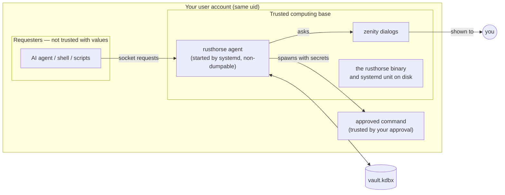

# Threat model

This document states what Rusthorse protects, against whom, how, and — just
as important — what it does not protect. If you find a gap between this
document and the code, that is a bug; please report it
([SECURITY.md](../SECURITY.md)).

- Applies to: Rusthorse 0.1.x
- Last reviewed: 2026-10-31

## 1. Scope and summary

Rusthorse is a local, single-user secrets vault for Linux desktops. A
long-running agent holds the decrypted KeePass database; clients (the CLI,
scripts, AI coding agents) ask it to *use* secrets. The design goal is:

> A program that needs a secret — in particular an AI agent with shell
> access — can use it for a purpose the human approved, without the value
> entering that program's memory, output, logs or context.

Rusthorse is **not** a sandbox and does not turn a compromised user account
into a safe one. The strongest guarantees hold against a *cooperative but
fallible* requester; against a requester that is actively hostile and runs
code as the same user, Rusthorse raises the cost and leaves a trail, but the
limits in [section 7](#7-known-limitations-and-residual-risks) apply.

## 2. Assets

| Asset | Why it matters |
|---|---|
| Secret values (`Password` field) | The thing being protected. |
| Notes and other protected fields | Often contain recovery codes or secondary secrets. |
| The master password | Unlocks everything, including copies of the vault elsewhere. |
| Approval decisions | The human's control over *what* a secret is used for. |
| Metadata (names, usernames, URLs, hosts, ports, tags) | Reveals what you have access to; useful for targeting. Treated as low sensitivity. |
| The vault file | Encrypted at rest; exposed to offline guessing if copied. |
| The audit log | Lets you notice misuse after the fact. |

## 3. Adversaries

| # | Adversary | Capabilities | Design target? |
|---|---|---|---|
| A1 | **Fallible AI agent** — cooperative, but makes mistakes, over-shares in output, or follows instructions planted in content it reads (prompt injection) | Runs commands as you through its shell tool; reads files; sees command output | **Primary** |
| A2 | **Hostile requester as the same user** — a fully prompt-injected agent or a malicious script deliberately trying to obtain secrets | Everything A1 can do, deliberately; can write its own socket client | Partially (raise cost, make visible) |
| A3 | **Malware running as you** with persistence | Can modify your files, binaries, shell startup, systemd units | No — see L1 |
| A4 | **Other local users** | Their own uid; no root | Yes |
| A5 | **Someone with a copy of the vault file** (backup, sync service, stolen disk) | Offline computation | Yes |
| A6 | **Root, the kernel, hardware attacks, physical access to an unlocked session** | Everything | No |

## 4. Trust boundaries

The boundary that matters is between **requesters** and the **agent**. The
agent, its dialogs and the files it is started from are trusted. An approved
command is trusted with the secrets you approved for it — that is what
approving means.

## 5. Assumptions

1. The agent is started by systemd (or another process outside any requester's
   control), from a binary and unit file the requester has not modified.
2. The kernel enforces Yama `ptrace_scope ≥ 1` (the default on Ubuntu, Mint,
   Debian, Fedora), so a process can only inspect its own descendants.
3. The human reads the approval dialog before answering.
4. The master password is strong and not reused.
5. The desktop session is not controlled by an attacker (see L2 for X11).

## 6. Security properties and how they are provided

| # | Property | Mechanism | Holds against |
|---|---|---|---|
| P1 | A requester never receives a secret value, note or protected field without an approval for that specific request. | Only `reveal` returns a value, and only after a non-rememberable approval. `list`/`show` return metadata only. | A1, A2 |
| P2 | **What is approved is what runs.** | The agent resolves the program to a canonical path, fixes the argument list, directory and environment, shows them, and spawns the command itself ([ADR 0002](adr/0002-agent-mediated-execution.md)). A custom client cannot substitute another command. | A1, A2 |
| P3 | Secrets used by `run` are not placed in any process the requester can inspect. | The command is a child of the agent, not of the requester; the requester's tree cannot `ptrace` it (Yama). See L3 for `/proc/<pid>/environ`. | A1, A2 (partially) |
| P4 | Secret values printed by an approved command do not reach the requester verbatim. | Output passes through pipes owned by the agent and an exact-match redactor; a modified client cannot disable it (the agent owns the pipes). | A1 (see L5) |
| P5 | The master password never passes through a requester. | The agent asks for it in its own dialog; the protocol has no field for it. | A1, A2 |
| P6 | Dialogs are not answered by the requester and say what they mean. | Dialogs are separate processes on the desktop, not in the terminal; requester-controlled text is escaped (control, bidi and zero-width characters) and truncated; default button is Deny; unanswered dialogs are denied. | A1, A2 (see L2) |
| P7 | Only your user can talk to the agent. | Socket in a `0700` directory, mode `0600`, and an `SO_PEERCRED` uid check. | A4 |
| P8 | The decrypted vault is not held longer than needed. | Auto-lock after 15 minutes of inactivity (configurable), `rusthorse lock`, remembered approvals cleared on lock. | A1, A2, A6 (reduces window) |
| P9 | The agent's memory is not readable by other same-user processes and is not written to core dumps. | `PR_SET_DUMPABLE=0`, `RLIMIT_CORE=0`. | A1, A2 |
| P10 | The vault is confidential at rest. | KDBX4: AES-256, Argon2id (64 MiB, 20 passes for new vaults). Files `0600`, directories `0700`. | A4, A5 |
| P11 | Every decision leaves a record. | Append-only JSON Lines audit log; approval-gated actions fail closed if it cannot be written. | A1, A2 (detection; see L13) |
| P12 | Changes made by other programs are not silently lost. | The agent refuses to save if the file changed since it was loaded. | Accidents |

### Who starts the agent

A process can read the memory of the processes it starts (with the default
Yama setting), preload code into them (`LD_PRELOAD`) and change their
environment. If an AI agent's shell started `rusthorse agent`, it could do all
of that before the agent had a chance to protect itself. That is why the agent
must be started by systemd: it is then outside every requester's process tree.
`rusthorse agent` prints a warning when its parent is not systemd. The agent
also marks itself non-dumpable at startup, which blocks inspection by any
other unprivileged process from then on.

## 7. Known limitations and residual risks

**L1 — Malware running as you can defeat Rusthorse.** It can replace the
`rusthorse` binary, the systemd unit or your shell startup files, wait for you
to unlock, and capture the master password or the decrypted data. No program
running with your privileges can prevent this. *Mitigation:* keep the account
clean; future work could run the agent as a separate system user.

**L2 — X11 lets any program click your dialogs.** On X11, every client can
synthesize keyboard and mouse input (`xdotool`) and read other windows. A
hostile requester could find the approval dialog and press "Allow once", or
log the master password as you type it. *Mitigation:* prefer a Wayland
session, where clients are isolated; the default button is **Deny** and
dialogs time out, which only helps against accidents. This is the most
important limitation on X11 desktops such as Cinnamon and MATE.

**L3 — The environment of a running approved command is readable.** While an
approved command runs, any process of the same user can read
`/proc/<pid>/environ`, which contains the secret. Marking the process
non-dumpable would prevent that, but `execve` resets the flag. *Mitigation:*
short-lived commands minimize the window; the planned SSH agent and HTTP
proxy keep secrets out of the environment altogether.

**L4 — Approving a command trusts everything it executes.** If you approve
`python deploy.py`, the secret goes to whatever `deploy.py` contains when it
runs — and an AI agent can edit that file, including between the dialog and
execution. The same applies to `sh -c '…'`, interpreters with inline code,
configuration files the program reads (`~/.gitconfig`, `.npmrc`) and plugins.
The agent removes `LD_*` variables and warns about a list of variables that
change what programs execute, but that list cannot be complete.
*Mitigation:* read the dialog; prefer approving well-known binaries with
explicit arguments; review recent changes to scripts before approving them.

**L5 — Redaction only catches exact copies.** A command that prints the
secret encoded (base64, hex, URL-encoded), split, reversed or partially is not
redacted. Secrets shorter than 4 characters are never redacted. Redaction
prevents *accidental* disclosure (debug output, error messages, echoing
configuration); it is not a defense against a command written to leak.

**L6 — Metadata is visible without approval.** While the vault is unlocked,
any process of your user can list entry names, usernames, URLs, hosts, ports
and tags. This is deliberate (an agent needs to know what exists and where it
points), but do not put secrets in those fields; use notes or the value.

**L7 — Memory hygiene is best effort.** Rusthorse wipes the buffers it
controls (`Zeroizing`), but copies made by JSON parsing, the KeePass library
and the standard library's process spawning are not all wiped. Memory is not
locked, so secrets can reach swap or a hibernation image. *Mitigation:* use
full-disk encryption (which also covers swap).

**L8 — Remembered approvals widen the window.** "Allow for 10m" approves
identical requests without asking. "Identical" covers the command line,
program path, directory, secrets and risky variables — not the contents of
files the command reads. *Mitigation:* use it only for commands whose inputs
you trust; lower `--remember` or set it to `0` to disable it.

**L9 — Dialog information can mislead.** Process names in the requester
chain are chosen by the processes themselves and pids can be reused; very
long command lines are truncated (and never remembered); a flood of requests
can cause approval fatigue. *Mitigation:* treat unexpected dialogs as a
warning sign; deny when in doubt.

**L10 — The vault can be attacked offline.** Anyone with a copy of the file
can try passwords at a cost set by Argon2id. A weak master password will fall.
*Mitigation:* a long, unique passphrase.

**L11 — Command lines are not secret.** Arguments are shown in dialogs,
stored in the audit log and visible to other processes. Never put a secret on
a command line; pass it through `run`.

**L12 — Denial of service.** Any process of your user can lock the vault,
fill the screen with requests (shown one at a time), or stop the agent. This
is an annoyance, not a disclosure.

**L13 — The audit log is not tamper-proof.** Any process of your user can
edit or delete it. It helps you notice misuse by a cooperative-but-wrong
agent; it is not evidence against a hostile one.

**L14 — `reveal` and `import` move values through the client.** `reveal`
returns the value to the requesting process (that is its purpose, which is
why it is never remembered); `import` reads values in the client before
sending them to the agent. Neither should be run by an AI agent.

## 8. Recommendations

- Start the agent only through the systemd unit.
- Prefer a Wayland session, and use full-disk encryption.
- Give AI agents narrowly scoped, revocable credentials (per-repository
  tokens, API keys with spending limits), stored as separate entries.
- Keep `--idle-timeout` short and lock when you step away.
- Read every dialog; be suspicious of `sh -c`, project scripts the agent just
  edited, unexpected programs or directories, and risky-variable warnings.
- Look at `rusthorse audit` from time to time.

## 9. Planned improvements

- **SSH agent and local API proxy**, so that common secrets (SSH keys, HTTP
  bearer tokens) are used *by the agent* and never placed in a command's
  environment (addresses L3 and most of L4/L5 for those cases).
- **Per-entry policies**: restrict an entry to listed programs or hosts, or
  require approval every time.
- **Running the agent as a separate system user**, which would address part
  of L1 and L3 at the cost of a root-installed service.
- **Wayland-native dialogs** and a GTK interface.
- Signed release artifacts.

## 10. Review history

| Date | Review |
|---|---|
| 2026-10-31 | Initial threat model, written with the first implementation. |
